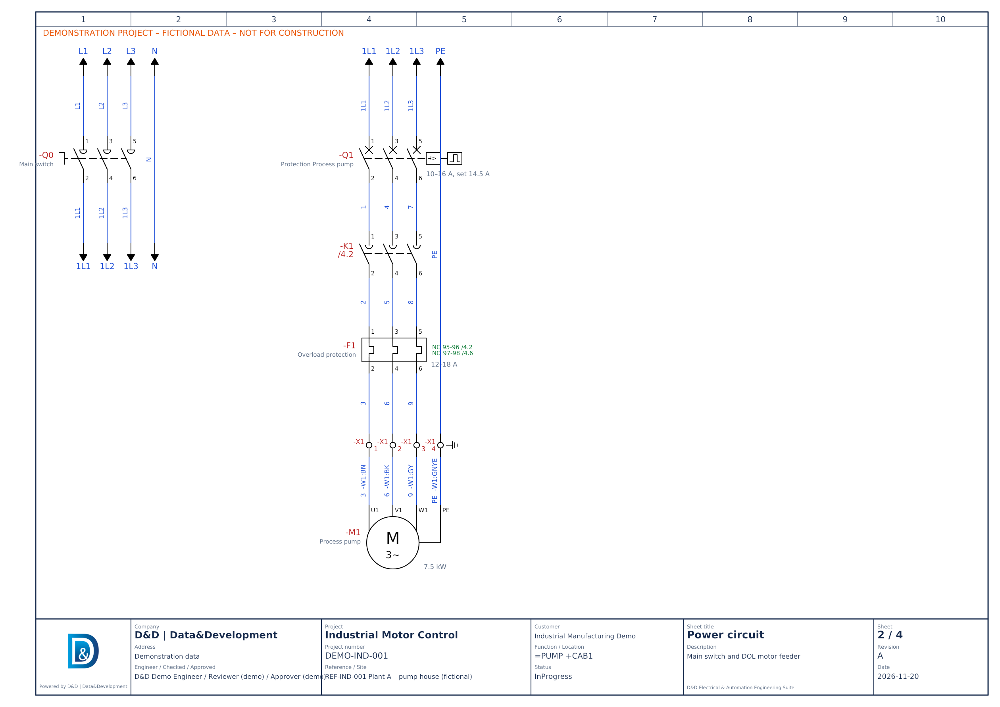
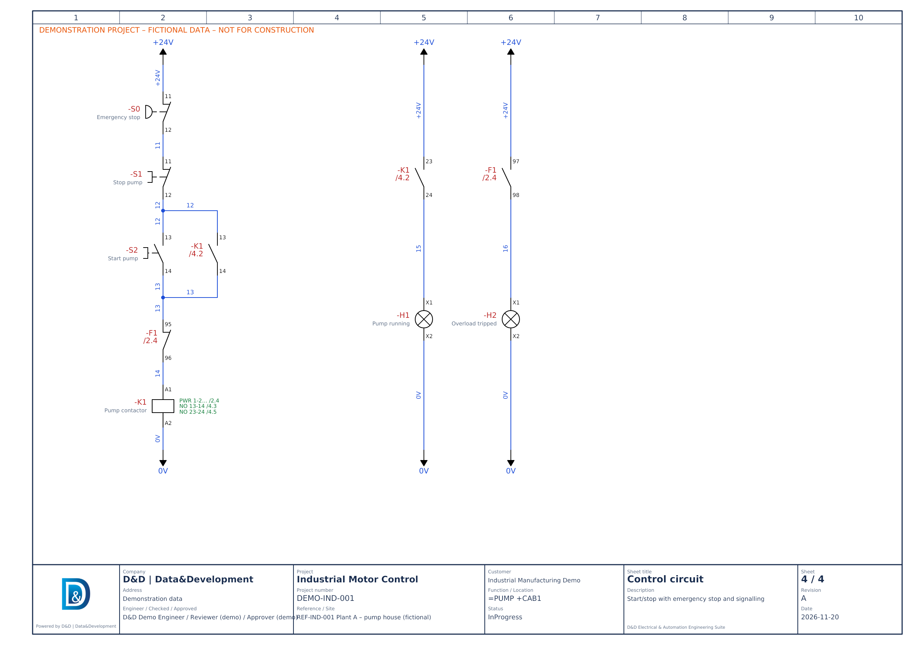
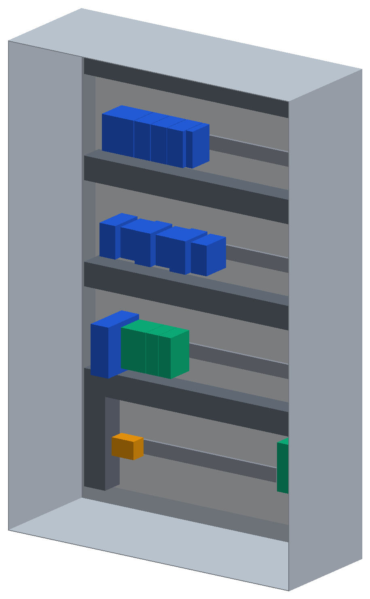
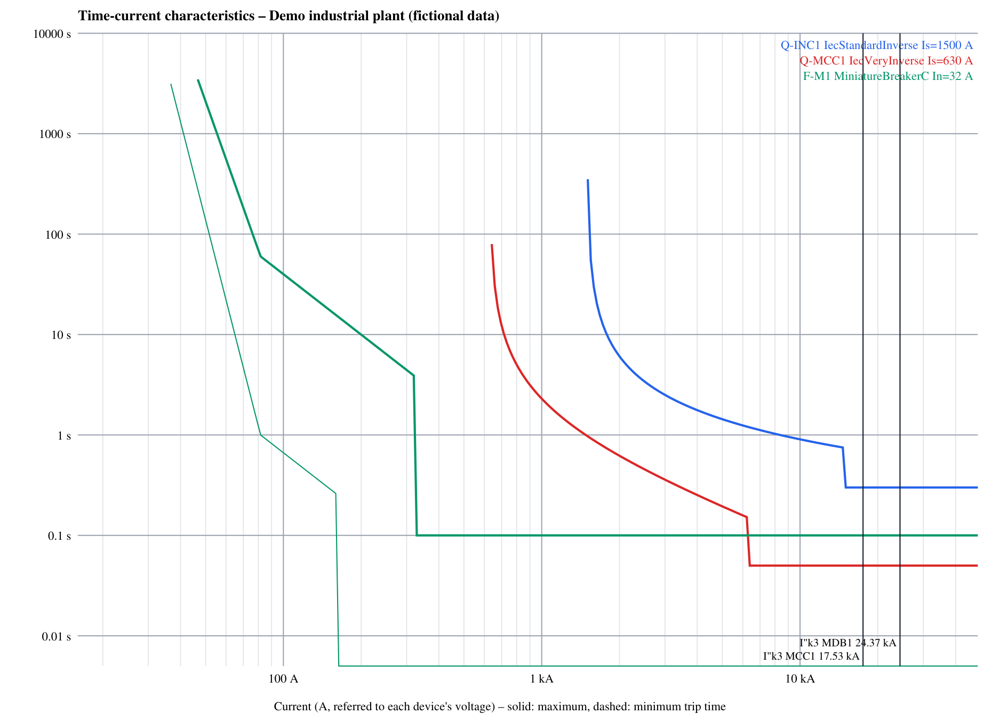

title: User Manual
subtitle: Installation, licensing and complete functional guide
product: D&D Electrical & Automation Engineering Suite
shortname: D&D Engineering Suite
tagline: One Platform. Multiple Engineering Disciplines. Unlimited Possibilities.
version_label: Version 0.5.0
edition_date: 2026-11-20
edition_label: Edition {date}
language_label: Language: English
author: D&D | Data&Development
author_line: Author & Developer: D&D | Data&Development
copyright: © 2026 D&D | Data&Development. All rights reserved.
powered: Powered by D&D | Data&Development
page: Page
figure: Figure
toc_title: Contents
keywords: electrical CAD, automation, PLC, power systems, load flow, short circuit, 3D, BIM, IFC, digital twin
---
### About this manual

This manual describes **D&D Electrical & Automation Engineering Suite** version 0.5.0 (short name **D&D Engineering Suite**), from installation and licence activation to the last function of every module. It is written for electrical, automation and power-system engineers, designers, project managers, maintenance teams and licence administrators.

| Item | Information |
|---|---|
| Product | D&D Electrical & Automation Engineering Suite |
| Short name | D&D Engineering Suite |
| Product identifier | DND-EAES |
| Version | 0.5.0 |
| Author | D&D | Data&Development |
| Developer | D&D | Data&Development |
| Publisher and copyright holder | D&D | Data&Development |
| Tagline | One Platform. Multiple Engineering Disciplines. Unlimited Possibilities. |
| Motto | One engineering object. Multiple engineering representations. One connected lifecycle. |
| Manual edition | 2026-11-20, English (a French edition is available) |

### Copyright and legal notices

© 2026 D&D | Data&Development. All rights reserved. No part of this software or documentation may be reproduced or distributed without the written permission of D&D | Data&Development, except as permitted by the licence agreement delivered with the product.

**No certification.** Calculations, studies, checks and reports are preliminary engineering aids based on documented methods. They do not certify compliance with any standard (IEC, IEEE, NF C, EN or other) and they do not replace verification by a qualified engineer against the licensed standards and the manufacturers' data.

**Demonstration data.** All demonstration projects, customers, products, prices, network data and certificate records delivered with the software are fictional and are marked as demonstration data.

**Simulated data.** Values produced by the built-in digital-twin simulator are always labelled as simulated and are never presented as field measurements.

**Trademarks.** Names of standards bodies, manufacturers, software products and protocols mentioned in this manual (for example IEC, IEEE, Siemens, Rockwell Automation, Schneider Electric, Mitsubishi Electric, Omron, ABB, WAGO, Phoenix Contact, SAP, Microsoft, Windows, Anthropic, Claude, Modbus, MQTT, OPC UA) belong to their respective owners. Their mention describes compatibility or terminology only and implies no endorsement or partnership.

### Third-party components

The suite uses the following open-source components under their own licences: .NET (MIT), Entity Framework Core with SQLite and Npgsql providers (MIT / PostgreSQL licence), SkiaSharp (MIT), HelixToolkit.Wpf (MIT), Xbim.Essentials (CDDL), MQTTnet (MIT), the Anthropic C# SDK (MIT), ClosedXML (MIT), CommunityToolkit.Mvvm (MIT), Serilog (Apache 2.0) and the DejaVu fonts (free licence, see `resources/Fonts/DejaVu-LICENSE.txt`).

### Conventions used

- **Bold** text names buttons, menus, windows and fields, for example **Engineering ▸ Validate**.
- `Monospace` text is something you type: commands, file names, addresses, tags.
- The symbol ▸ separates a ribbon tab or menu from the command inside it.
- Notes in a blue box contain important limitations or safety information.

[[PAGEBREAK]]
[[TOC]]

# Introduction

## What the suite is

D&D Electrical & Automation Engineering Suite is a modular engineering platform. It combines in one project file:

- electrical schematic CAD with real connectivity, symbol libraries, wiring, cables, terminals, PLC I/O and control-cabinet layout;
- engineering calculations with transparent reports;
- power-system studies (**D&D PowerStudio**): load flow, short circuit, protection coordination and harmonics;
- automation engineering: instruments, control loops, alarms, cause and effect matrices and control-system architecture;
- 3D cabinets and cable trays with clash detection, and IFC (BIM) exchange;
- a digital twin connected to Modbus TCP and MQTT;
- documentation generation, project lifecycle management, integrations and an engineering assistant.

## One engineering object, many representations

Every physical component is one **engineering object** identified by a permanent identity. The same object appears as a schematic symbol, in the equipment list, the cabinet layout, the 3D model, the IFC export, the PLC I/O list, the cable schedule, maintenance and commissioning records and digital-twin points. When two representations disagree (for example a different tag or rating), the software shows the conflict and only synchronises after you choose which value is correct.

## Modules

The suite is sold per module. The table shows each module and its main functions; the licence decides which modules are active on your computer.

| Code | Module | Main functions |
|---|---|---|
| ELEC | Electrical Engineering | Schematics, connectivity, wiring, cables, terminals, 2D cabinet layout, calculations, validation |
| AUTO | Automation Engineering | PLC configuration, instruments, loops, alarms, cause and effect, control architecture, loop diagrams |
| POWER | D&D PowerStudio | Load flow, IEC 60909 short circuit, protection coordination, harmonics, power calculators |
| 3D | 3D Engineering | 3D cabinets, equipment, cable trays, clashes, sections, glTF/GLB/STL export |
| BIM | BIM Engineering | IFC4 export and import |
| INFRA | Infrastructure Engineering | Data center, solar, railway, oil and gas templates and calculators |
| TWIN | Digital Twin | Live values from Modbus TCP, MQTT or the simulator, alarms and trends |
| AI | Engineering Assistant | Local or Claude assistant with confirmed proposals and audit trail |
| DOCS | Documentation Engineering | PDF, Excel, CSV, DXF, SVG, PNG, handover packages |
| CATALOG | Equipment Catalog | Manufacturer-neutral catalogue, procurement |
| PROJECT | Project Management | Lifecycle, approvals, registers, maintenance, commissioning |
| INTEGRATION | External Integrations | ERP, CMMS and webhook connectors |

## Where to start

1. Install the software (chapter 3) and activate a licence or the evaluation licence (chapter 4).
2. Open a demonstration project from the start page (chapter 5).
3. Follow the tutorial *Your first schematic*, offered when you open the schematic editor.
4. Use this manual as a reference for each module.

# System requirements

## Desktop application

| Item | Requirement |
|---|---|
| Operating system | Windows 10 version 2004 (build 19041) or later, or Windows 11, 64-bit |
| Runtime | .NET 10 Desktop Runtime (included in the self-contained installer) |
| Processor | 64-bit, 4 cores recommended (PowerStudio and 3D benefit from faster CPUs) |
| Memory | 8 GB minimum, 16 GB recommended for large projects |
| Display | 1600 × 900 or larger; 3D viewer requires DirectX-capable graphics |
| Disk | About 500 MB for the application, plus your projects |
| Network | Not required for local work; required for online licence activation, the licence server, Modbus/MQTT field connections, webhooks and the Claude assistant |

## Command-line tool

The command-line tool `dnd-electrical` runs on Windows, Linux and macOS with the .NET 10 runtime. It provides batch validation, numbering, exports, studies, 3D/IFC exports, integrations and licence management.

## Licence server (administrators)

The licence server is an ASP.NET Core application running on Windows or Linux with the .NET 10 ASP.NET Core runtime, behind HTTPS. It stores its data in a SQLite database.

# Installation

## Installing the desktop application

1. Download `DND-Electrical-Engineering-Suite-Setup.exe` from D&D | Data&Development.
2. Run the installer. Windows may ask for administrator permission.
3. Read and accept the licence agreement.
4. Choose the installation folder. The default is `C:\Program Files\DND\Engineering Suite`.
5. Choose the optional tasks: install the demonstration projects and create a desktop shortcut.
6. Click **Install**, then **Finish**. You can start the application immediately.

The installer registers the `.dndx` project file type, so double-clicking a project opens it in the suite. The .NET runtime is included; no separate download is needed.

## Data locations

| Data | Location |
|---|---|
| Settings (`settings.json`) | `%LOCALAPPDATA%\DND\ElectricalSuite` |
| Licence files and licence state | `%LOCALAPPDATA%\DND\ElectricalSuite\Licensing` |
| Encrypted secrets (assistant API key) | `%LOCALAPPDATA%\DND\ElectricalSuite\secrets.bin` |
| Autosave recovery files | `%LOCALAPPDATA%\DND\ElectricalSuite\Recovery` |
| Log files | `%LOCALAPPDATA%\DND\ElectricalSuite\Logs` |
| Custom symbol libraries | `%LOCALAPPDATA%\DND\ElectricalSuite\Symbols` |
| Plugins | `%LOCALAPPDATA%\DND\ElectricalSuite\Plugins` |
| Custom help articles | `%LOCALAPPDATA%\DND\ElectricalSuite\Documentation` |
| Demonstration projects (installer option) | `Public Documents\DND Electrical\Demo projects` (Start menu shortcut *Demo projects*) |
| Demonstration projects opened from the start page | `%LOCALAPPDATA%\DND\ElectricalSuite\DemoProjects` |
| User manuals (PDF, English and French) | `<installation folder>\Manual` (Start menu shortcuts) |
| Projects | Wherever you save them (`.dndx` files), with `.dndx.backups` folders beside them |

## Updating

Run the installer of the new version. Settings, licences, libraries and projects are kept. Projects created with an older version are upgraded automatically the first time they are opened and saved; keep the backup copy if you must return to the old version.

## Uninstalling

Use **Windows Settings ▸ Apps ▸ D&D Electrical & Automation Engineering Suite ▸ Uninstall**. Your projects and the settings folder `%LOCALAPPDATA%\DND\ElectricalSuite` are kept. Deactivate an online licence before uninstalling if you want to reuse the activation on another computer (chapter 4).

## Installing the command-line tool

The command-line tool is included in the installation folder. On Linux or macOS, administrators can publish it from the source code:

```
dotnet publish src/DND.Electrical.Cli -c Release -o ./dnd-cli
./dnd-cli/dnd-electrical --help
```

## Building from source (developers)

With the .NET 10 SDK:

```
./scripts/build.sh
dotnet run --project src/DND.Electrical.App
```

`build.sh` (or `build.ps1` on Windows) builds the solution and runs all test suites. The Windows installer is produced with `scripts/publish-windows.ps1` and Inno Setup (`installers/DND-Electrical-Setup.iss`).

# Licensing and activation

## Principles

Each module is licensed separately. A licence is a file signed by D&D | Data&Development with a cryptographic signature (ECDSA P-256); the application verifies the signature offline and refuses any modified licence. Licences can be:

| Subscription | Description |
|---|---|
| Monthly / Annual | Time-limited subscription |
| Perpetual | Permanent right to use the licensed version |
| Perpetual with maintenance | Permanent licence with updates until the maintenance end date |
| Enterprise | Organization-wide agreement |
| Trial / Evaluation | Time-limited evaluation |

| Seat model | Description |
|---|---|
| Device | Bound to the activated computers (maximum number of devices) |
| Named user | Assigned to named users |
| Floating | Concurrent seats leased from the licence server |

A licence may allow offline use or require online revalidation at an interval. After expiry a grace period applies; when it ends, projects remain readable (read-only) but licensed functions stop. **Project data is never deleted or encrypted because of a licence.**

## Opening the licensing page

Choose **Help ▸ Licensing** or click the licence status in the status bar. The page shows:

- licence status (Valid, Grace period, Expired, Revoked, Suspended, Invalid signature, Wrong device, Clock tampered or Not activated);
- licence identifier, owner, organization, subscription type and seat model;
- validity start, expiration, maintenance end, offline policy and grace period;
- the identifier of this device and the device the licence is bound to;
- the list of the twelve modules with *Licensed* or *Not licensed* and their maturity status.

## Evaluation licence

Click **Install evaluation licence**. The evaluation licence enables all modules until 31 December 2027 for evaluation use only. From the command line: `dnd-electrical license evaluation`.

## Online activation

1. Enter the **licence key** received from D&D | Data&Development (format `XXXX-XXXX-XXXX-XXXX-XXXX`).
2. Check the **licence server URL** (provided with your key).
3. Click **Activate**. The server checks the key and the number of activated devices, then returns a licence bound to this computer.
4. Use **Refresh** to renew the licence (for example after a renewal or a module change) and **Deactivate** to release this computer's activation.

## Offline activation

For computers without internet access:

1. Click **Export activation request** and enter your licence identifier. A request file is created.
2. Send the file to your licence administrator.
3. The administrator creates a device-bound licence in the License Administration Portal (**Offline activation**).
4. Click **Import licence file** and select the received `.dndlic` file.

From the command line: `dnd-electrical license request <licenceId> request.json` and `dnd-electrical license install licence.dndlic`.

## Floating licences

With a floating licence, the application checks out a seat from the licence server when it starts, sends a heartbeat while it runs and releases the seat when it closes. If all seats are used, the licensed functions stay unavailable until a seat is free.

## What happens when a module is not licensed

The command is not hidden: when you open it, an upgrade page shows the module name and purpose, the reason and how to obtain it. Enforcement happens inside the engines, so a function cannot be used by any other path. Without the **ELEC** module, projects open in **read-only** mode: you can view, select, pan and zoom but not edit.

## Security protections

- The licence signature is checked every time the licence is evaluated.
- If the computer clock is set back more than 24 hours before the last recorded use, licensed functions are locked until the next online refresh.
- Revoked licences are detected through refreshed licences and a signed revocation list.
- The device identifier is a salted hash of the product identifier, computer name, operating-system platform and a random installation identifier; no hardware serial numbers or personal data are used.

## License Administration Portal (administrators)

The licence server includes a web portal at its root address. After logging in, administrators can:

- create customers and organizations;
- issue licences (modules, subscription, seat model, limits, validity, offline policy, grace period);
- renew, extend, suspend, reactivate or revoke licences, and change modules;
- view and release device activations, process offline activation requests;
- view usage and the audit log, and export a CSV licence report.

Start the server with the signing key path and a bootstrap administrator password of at least 12 characters:

```
dotnet run --project src/DND.Electrical.LicenseServer -- --Licensing:SigningKeyPath=/secure/signing-key.pem --Licensing:BootstrapAdminPassword='<password>'
```

Deploy it behind HTTPS. The private signing key exists only on the server; back up the database and the key separately. The tool `dnd-license` (`keygen`, `issue`, `verify`, `request-info`) supports offline administration.

# Getting started and user interface

## Start page

When the application starts without a project, the start page shows:

- **New project**, **Open project…** and **Import archive…**;
- the list of recent projects;
- the ten demonstration projects (fictional data);
- recoverable projects after an unexpected shutdown;
- links to the help center and the *Getting started* tutorial.

## Main window

- **Ribbon** with the tabs Home, Project, Drawing, Insert, Engineering, Calculation, Reports, View, Tools and Help.
- **Left panel**: Project Explorer (sheets, devices, cables, terminal strips, PLCs, motors, cabinets, calculations, revisions, attachments), Symbol Browser, search results and Layers.
- **Centre**: drawing tabs; several sheets can be open at the same time.
- **Right panel**: Properties of the selected object.
- **Bottom panel**: command line, validation messages and output log.
- **Status bar**: last message, grid/snap/ortho state, active sheet, cursor coordinates (mm) and licence status.

## Ribbon reference

| Tab | Commands |
|---|---|
| Home | New, Open, Save, Save as, Close, Undo, Redo, Copy, Cut, Paste, Delete, Validate, Calculations, Drawing PDF |
| Project | New sheet, Rename, Delete sheet, Properties, New revision, Version history, Attach file, Company logo, Duplicate, Export archive, Import archive |
| Drawing | Select, Pan, Zoom all, Wire, Line, Polyline, Rectangle, Circle, Arc, Text, Dimension, Callout, Move, Copy, Rotate 90°, Mirror, Duplicate, Group, Ungroup, Align left, Align top |
| Insert | Insert selected symbol, Symbol editor, DXF import, Catalogue import |
| Engineering | Number wires, Renumber all, Renumber devices, Sync terminals, Engineering data, Integrations, Digital twin, Automation, PowerStudio, 3D layout, Project mgmt, Validate |
| Calculation | Calculation workspace, Methodology |
| Reports | Drawing set PDF, Reports…, Handover package, DXF, SVG, PNG, JSON, XML |
| View | Grid, Snap, Object snap, Ortho, Theme, beginner/advanced mode |
| Tools | Settings, Symbol editor, Plugins, Assistant |
| Help | Help center, Getting started, Shortcuts, What's new, Licensing, About |

## Keyboard shortcuts

| Shortcut | Action |
|---|---|
| Ctrl+N / Ctrl+O | New project / Open project |
| Ctrl+S / Ctrl+Shift+S | Save / Save as |
| Ctrl+Z / Ctrl+Y | Undo / Redo |
| Ctrl+C / Ctrl+X / Ctrl+V | Copy / Cut / Paste |
| Ctrl+D | Duplicate selection |
| Ctrl+A | Select all |
| Ctrl+Shift+P | Command palette |
| Ctrl+F | Search everywhere |
| F1 | Help center |
| F7 / F9 / F10 | Toggle grid / snap / ortho |
| F8 | Validate project |
| R / X | Rotate / mirror the symbol being placed |
| Esc | Cancel the current tool |
| Shift (hold) | Temporarily disable ortho |
| Alt (hold) | Temporarily disable snapping |

## Finding commands and objects

- **Command palette** (Ctrl+Shift+P): type part of any command name, including the module windows.
- **Search everywhere** (Ctrl+F): sheets, devices, wires, cables, PLC tags and help articles.
- Tooltips show the purpose and shortcut of each button.

## Themes and modes

**View ▸ Theme** switches between light and dark. The accent colour is set in **Tools ▸ Settings**. *Beginner mode* hides advanced ribbon groups (Modify, Import, Archive, sheet and data exchange); *Advanced mode* shows everything.

## Help center and tutorials

Press **F1** for the help center: searchable articles, the calculation methodology and the tutorials. Tutorials guide you step by step and highlight the next action. Administrators can add or override help articles (stored in the user documentation folder) and publish them.

# Projects

## Creating a project

1. **Home ▸ New** (Ctrl+N).
2. Choose a template (table below).
3. Enter the project number, name, customer, company, engineer and site. These values fill every title block.
4. Click **Create**, then **Save as** to choose the file name (`.dndx`).

| Template | Content |
|---|---|
| Blank project | Cover sheet only |
| Industrial installation | Power distribution and control circuits |
| Manufacturing plant | Machine power, control and PLC sheets (IEC 60204-1 oriented profile) |
| Oil and Gas | MCC, ESD interface, instrumentation and hazardous-area register |
| Water treatment | Pumping stations, instrumentation and PLC I/O |
| Power distribution | Transformer, main distribution board, outgoing feeders |
| Building installation | Distribution boards, lighting and sockets (NF C 15-100 profile) |
| HVAC systems | Fans, pumps, compressors, drives and BMS interface |
| Industrial automation | PLC-centred project with I/O sheets |
| Renewable energy | PV/storage AC side |
| Data center | Single-line diagram, UPS A/B, PDUs, EPMS/BMS |
| Solar PV plant | Strings, combiner boxes, inverters, AC collection, grid connection, monitoring |
| Railway station / depot | Station LV distribution, signalling power, platform lighting, SCADA interfaces |

Templates set the nominal voltage, earthing system and standard profile (IEC 60364, IEC 60204-1 or NF C 15-100) used by the calculations.

## Project properties

**Project ▸ Properties** edits the project data, status (Draft, In progress, For review, Approved, For construction, As built, Archived), industry, nominal voltage and earthing system. **Project ▸ Company logo** sets the logo used in title blocks and reports.

## Saving, backups and locking

- Saving is **atomic**: the project is written to a temporary file which then replaces the original.
- Before each save the previous version is copied to `<project>.dndx.backups` (the last 10 by default). **Project ▸ Version history** restores one.
- Unsaved changes are written to a recovery copy every few minutes (never to your file). After a crash the start page offers to recover it.
- Opening a project creates a lock file. If someone else has it open you see who and since when, and can only open it by explicitly forcing the lock.

## Revisions, archives and attachments

- **Project ▸ New revision** issues a revision (code, description, author); all sheets take the new revision code.
- **Export archive** creates a `.dndpkg` package; **Import archive** checks the package before extracting it.
- **Duplicate** copies the project with a new identity and number.
- **Attach file** stores datasheets, photos and PDFs (up to 100 MB each) inside the project.
- Every significant action is recorded in the project **audit trail**.

# Schematic drawing

## Sheets

Sheets use A0 to A4 formats (A3 landscape by default) with a frame, numbered reference columns and a title block. Fields such as `{PROJECT.NAME}`, `{PROJECT.NUMBER}` or `{SHEET.NUMBER}` are filled automatically. Use **Project ▸ New sheet**, **Rename** and **Delete sheet** to manage them.



## Drawing tools

| Tool | Command | Use |
|---|---|---|
| Line | `L` | Click start and end; continues from the last point |
| Polyline | `PL` | Click points, Enter to finish, `C` to close |
| Rectangle | `REC` | Two corners |
| Circle | `C` | Centre and radius |
| Arc | `A` | Start, point on arc, end |
| Text | `T` | Insertion point, then the text |
| Dimension | `DIM` | Two points and the dimension line position |
| Callout | `LE` | Arrow point, bend points, Enter, then the text |

## Precise input

Type coordinates in the command line: `100,50` (absolute), `@20,0` (relative) or `@50<45` (polar: distance and angle).

## Snapping

Grid snap (5 mm by default), object snap (end points, midpoints, centres, pins) and ortho (horizontal and vertical). Hold **Shift** to disable ortho temporarily and **Alt** to disable snapping.

## Selecting and editing

Click to select; Shift adds, Ctrl toggles. Drag from left to right for a *window* selection (objects fully inside) and from right to left for a *crossing* selection. Drag a selected object to move it. Rotate, mirror, align, group, ungroup, copy, paste and duplicate are in the Home and Drawing tabs. Every operation can be undone.

## Layers

Entities are placed on layers (WIRES, SYMBOLS, TAGS, ANNOTATIONS…). Layers can be hidden, locked or excluded from printing in the Layers panel.

# Symbols

## Symbol Browser

The browser lists all symbols by category with a preview. Search by name, identifier or keyword (English and French keywords). Double-click a symbol to place it: **R** rotates, **X** mirrors, **Esc** stops.

## Built-in library

The *D&D IEC Basic* library contains 46 original IEC 60617-style symbols: circuit breakers (1 to 4 poles), motor protection breakers, fuses, RCDs, switch-disconnectors, contactor coils and main contacts, auxiliary contacts (NO, NC, change-over), overload relays, motors, transformers, power supplies, VFDs, soft starters, push buttons, emergency stops, selector and limit switches, proximity, photoelectric and level sensors, temperature and pressure transmitters, lamps, horns, solenoid valves, heaters, socket outlets, terminals, connectors, potential feeds, interruption points and PLC I/O channels.

## Electrical behaviour of symbols

Each symbol declares a **role** (standalone device, main function such as a coil, child contact, terminal, potential feed, interruption point, PLC channel, connector), its **pins** with their exit direction, its **internal connections** and a default **tag prefix**.

## Custom symbols

1. **Tools ▸ Symbol editor**.
2. Start from scratch or duplicate a built-in symbol (built-in libraries are read-only).
3. Draw the graphics with the command line (L, PL, C, A, REC, T); the origin is the insertion point; use the 2.5 mm grid.
4. Add pins and attributes, set the role and tag prefix.
5. Save to a custom library. Each save increments the symbol version.

Libraries are JSON files (`*.dndsym.json`) that can be imported and exported. Projects keep a copy of every symbol they use, so they open correctly on other computers.

# Electrical connections

## Drawing wires

Select **Wire** (`W`). Click a pin to start; pins are highlighted with a cross marker. Click free space to add bend points and click another pin, a junction or an existing wire to finish. Routes are orthogonal and follow the pins' exit direction. Clicking the middle of an existing wire inserts a **junction** (T-connection).

## Connectivity

A wire stores *what* it connects (symbol and pin, or junction). Moving a symbol drags its wires along. Two symbols that only touch are **not** connected.

**Potentials** (equipotential groups) are computed from wires, junctions, internal symbol connections, potential feeds with the same name (L1, N, PE, +24V, 0V…) and interruption points with the same name (cross-sheet links). Interruption points show the location of their counterparts, for example `/5.3`.

## Wire properties

Wire number, colour, cross-section, type, physical length and cable core are edited in the Properties panel. If one potential connects two different named supplies (for example L1 and N), validation reports a short circuit.

# Numbering and cross-references

## Device tags

New devices receive the next free tag in the project format (default `-{PREFIX}{N}`, for example `-K3`). Prefixes come from the symbol: Q breakers, K contactors and relays, F protection, M motors, S switches, B sensors, H lamps, X terminals, T transformers and drives, G supplies, Y valves. **Engineering ▸ Renumber devices** renumbers unlocked tags in order of appearance; tags entered by hand are locked.

## Wire numbers

**Engineering ▸ Number wires** numbers unnumbered wires; **Renumber all** renumbers everything except locked numbers.

- *Per potential* (default): all wires of a potential share one number.
- *Per wire*: each wire is numbered individually.
- Wires of named potentials take the potential name (L1, +24V…).

Format tokens: `{GSEQ}` project sequence, `{SHEET}`, `{COL}`, `{SEQ}` sequence within the sheet, with optional zero padding such as `{GSEQ:000}`. Numbering can be undone.

## Devices and cross-references

A **device** is one physical component with a tag. It can be shown by several symbols: a contactor has a coil (main function) and contacts (children) on different sheets with the same tag. Contacts show the location of their coil (for example `/4.2` = sheet 4, column 2) and coils show a **contact mirror** listing each contact with its pins and location.



# Components, catalogue and bill of materials

## Device properties

Select a symbol to edit its tag, function text, location, manufacturer, part number and engineering properties (rating, voltage, settings, hazardous zone and Ex marking where relevant). Pin numbers of contacts can be overridden per symbol.

## Catalogue

Choose a part number from the catalogue in the **Part number** field: the manufacturer is filled in, product dimensions are used by the cabinet layout and 3D model, and prices feed the BOM. **Insert ▸ Catalogue** imports CSV or Excel files with the columns Manufacturer, PartNumber, Description, Category, UnitPrice, Currency, Supplier, Width, Height, Depth. Imported products are marked as verified catalogue data; bundled demonstration products are marked fictional and reported by validation rule VAL022. The software never invents manufacturer specifications.

## Bill of materials and procurement

The BOM is generated from devices, terminals, cabinet accessories (enclosures, DIN rails and ducts in metres) and cables (in metres), grouped by manufacturer and part number with quantities, prices, totals and procurement status. In **Engineering data ▸ Procurement status** set the status per part (not ordered, requested, quoted, ordered, delivered, installed, cancelled), the supplier and the purchase order.

# Cables and terminals

## Cables

Create cables in **Engineering data ▸ Add cable** (type, number of cores, cross-section, length, origin, destination, outer diameter). Cores receive IEC 60445 style markings (BN, BK, GY, BU, GNYE) or numbers. Assign a wire to a cable with the **Cable** field of the wire properties; the next free core is used (protective-earth cores last). The schematic shows the core next to the wire number, for example `-W1:BN`. The outer diameter is used by the cable tray fill check (chapter 15).

## Terminals

Place terminal symbols with the strip tag (for example `-X1`) and a terminal number. **Engineering ▸ Sync terminals** creates the strip definitions (terminal number, type, level, jumper group). The **terminal diagram** is generated from the actual wiring: panel-side and field-side connections, wire numbers and jumpers.

## Reports

The **cable schedule** lists used and spare cores; the **cable connection report** lists core, wire and from/to pins; the **wiring list** lists every connection.

# PLC configuration

## Stations and modules

Open **Engineering ▸ Engineering data ▸ PLC configuration**. Create a station (tag, name, addressing profile, IP address) and add generic modules: CPU, power supply, DI 8/16, DO 8/16, relay outputs, AI 4/8, AO 4, communication and remote I/O adapter.

| Addressing profile | Example digital input |
|---|---|
| Generic IEC 61131-3 | `%IX0.0` |
| Siemens-style | `%I0.0` |
| Rockwell-style | `Local:1:I.Data.0` |
| Schneider-style | `%I0.1.0` |
| Mitsubishi-style | `X000` (octal) |
| Omron-style | `CIO 0.00` |
| CODESYS-based (ABB, WAGO, Phoenix Contact) | `%IX0.0` |

> Addressing profiles are templates, not vendor catalogues, and the suite does not exchange data with vendor PLC programming software. Verify the addresses against your hardware configuration.

## Linking channels to schematics

Place PLC channel symbols (DI, DO, AI, AO) on the schematics and choose the channel in the **Channel** field of their properties. The symbol shows the address and PLC tag; the PLC I/O list shows the schematic location, field device and terminal. Instruments are assigned to channels from the Automation window (chapter 18).

# Control cabinet layout (2D)

1. **Engineering data ▸ Cabinet layout ▸ New cabinet**: enclosure width, height and depth; the mounting plate is derived.
2. Add **DIN rails** and **cable ducts**.
3. **Place device** by tag: the device is placed at the first free position of a rail, centred on it, with the dimensions of its catalogue product.
4. Door-mounted devices (pilot lights, push buttons) are stored with the *door* face.

The layout check reports items outside the mounting plate or the door, collisions on the plate and on the door, clearance violations and devices placed twice. Utilisation and free rail length are shown in the cabinet report. Cabinet items are linked to schematic devices: renaming a device updates the layout.

# 3D layout and BIM

## Opening the 3D window

Choose **Engineering ▸ 3D layout** (module 3D). If a device is selected in the schematic, the window opens on its 3D representation.

## Generating a cabinet in 3D

Select the cabinet and click **Generate 3D from 2D layout**. The suite builds the enclosure (back wall, side walls, roof, bottom, door), the mounting plate, DIN rails, ducts and devices with the same identities as the 2D layout. Devices on a rail sit on the rail; door devices sit behind the door. A clash check runs immediately.



## Plant layouts, equipment and cable trays

- **New plant layout…** creates an empty layout (room, plant area, tray network).
- **Add equipment…** with the syntax `TAG; W×D×H; X,Y,Z` (millimetres, centre point), for example `EQ1; 800×600×2000; 400,300,1000`. If the tag exists in the project, the equipment is linked to that device.
- **Add tray route…** with `TAG; W×H; x,y,z / x,y,z / …`, for example `TR-01; 300×60; 0,0,2500 / 4000,0,2500`. Cables whose route field contains the tray tag are assigned to it.
- **Tray fill** compares the sum of cable cross-sections (π/4 × outer diameter²) with the tray section and the fill limit (40 % by default, set per route). Cables without outer diameter are listed instead of estimated.

## Checks

- **Check clashes**: hard intersections between solids and clearance violations (cabinet device clearance or per-object clearance). Tray joints and cables inside trays are not reported.
- **Check 2D/3D sync**: lists objects not yet in 3D, removed or changed in the 2D layout, deleted engineering objects and tag differences. **Regenerate from 2D** replaces generated objects and keeps the objects you added.

## Navigation and analysis

Rotate with the right mouse button, pan with the middle button and zoom with the wheel; the view cube sets standard views. Click an object to select it. **Enclosure** hides walls and door; **Explode** separates objects; **Section** cuts the model along X, Y or Z at the chosen position and draws the section outline. **Measure to** shows the clear distance and centre distance between the selected object and another one. **Show in schematic** opens the sheet of the selected device. **Move…** moves an object by `dx,dy,dz`; for generated objects you can confirm to write the move back to the 2D layout. **Delete** removes objects you added (generated objects are removed in their source).

## Export and IFC

- **GLB / glTF / STL**: 3D exports (glTF in metres with Y up and engineering identities in node data; STL in millimetres).
- **IFC…** (module BIM): IFC4 export with project, site, building and storey, IFC electrical classes (distribution boards, protective and switching devices, motors, cable carriers, sensors) and the engineering identity in the property set `Pset_DnD_EngineeringObject`.
- **Import IFC…**: imports building or plant context; elements with an extruded rectangular body are converted, the others are counted and reported.

> STEP and IGES exchange is not available (it requires an external geometry kernel). Imported IFC geometry is limited to box-shaped bodies.

# Calculations

## Calculation workspace

Open **Calculation ▸ Calculation workspace**. Select a calculator, enter the values (use the point as decimal separator), click **Calculate** and **Store** to save the result in the project. Each result shows inputs, formulas with substituted values, steps, results with units, checks, assumptions, warnings, standard profile and status (Pass, Warning, Fail, Informational). Stored results appear in the calculation report.

| Calculator | Method | Module |
|---|---|---|
| Current from power | I = P/(k·U·cos φ·η) | ELEC |
| Power (P, Q, S) | S = k·U·I | ELEC |
| Power factor | cos φ = P/S | ELEC |
| Voltage drop | IEC 60364-5-52 Annex G | ELEC |
| Cable sizing | Iz with k1·k2, protective device coordination, voltage drop | ELEC |
| Circuit-breaker selection | Ib ≤ In ≤ Iz, Icu ≥ Ik | ELEC |
| TN maximum length | Lmax = 0.8·U0·Sph/(ρ(1+m)·Ia) | ELEC |
| Lighting | Lumen method N = E·A/(Φ·UF·MF) | ELEC |
| UPS redundancy | N, N+1, N+2, 2N, 2N+1 | ELEC |
| UPS battery autonomy | Energy method (preliminary) | ELEC |
| PUE | Facility energy / IT energy | ELEC |
| PV string sizing | Temperature-corrected Voc/Vmp against inverter limits | ELEC |
| Short-circuit current (radial) | IEC 60909 simplified | POWER |
| Transformer sizing | S = P·ks/cos φ·(1 + reserve) | POWER |
| Motor starting | In and starting current by method, voltage dip | POWER |
| Project load summary | From the load list and motors | POWER |
| Phase balancing | Single-phase loads | POWER |
| Power factor correction | Qc = P·(tan φ1 − tan φ2), resonance h = √(Sk/Qc) | POWER |
| Generator sizing | Running load and motor-start voltage dip | POWER |
| Earth rod resistance | Dwight formula | POWER |
| Earthing grid resistance | IEEE Std 80 (Sverak) | POWER |
| Tolerable touch and step voltages | IEEE Std 80, 50 or 70 kg | POWER |

> Results are preliminary engineering calculations and must be verified by a qualified engineer. Utilisation factors, generator reactances, battery data and PV module data must come from the manufacturers.

## Methodology summary

- **Voltage drop**: u = b·(ρ1·L/S·cos φ + λ·L·sin φ)·Ib, Δu = 100·u/U0; b = 1 (three-phase) or 2 (single-phase); ρ1 = 0.0225 Ω·mm²/m (Cu) or 0.036 (Al); λ = 0.08 mΩ/m.
- **Cable sizing**: k1 = √((θmax − θa)/(θmax − 30)); k2 from the grouping table; Ib ≤ In ≤ Iz and I2 ≤ 1.45·Iz; copper, methods C and E (data transcribed from IEC 60364-5-52, to be verified against your licensed copy).
- **Radial short circuit**: ZQ = c·Un²/S"kQ, ZT corrected by KT = 0.95·cmax/(1 + 0.6·xT), I"k3 = c·Un/(√3·|Zk|), ip = κ·√2·I"k3.
- **Earthing grid**: Rg = ρ·[1/LT + 1/√(20A)·(1 + 1/(1 + h·√(20/A)))].
- **Touch/step voltages**: Etouch = (1000 + 1.5·Cs·ρs)·k/√ts, Estep = (1000 + 6·Cs·ρs)·k/√ts, k = 0.116 (50 kg) or 0.157 (70 kg).
- **PV strings**: V(T) = V_STC·(1 + β·(T − 25)); maximum modules limited by the inverter maximum voltage and MPPT range.

# D&D PowerStudio

## Opening PowerStudio

Choose **Engineering ▸ PowerStudio** (module POWER). The network selector lists the networks stored in the project.

| Command | Purpose |
|---|---|
| New… | Empty network with a 20 kV supply bus and utility feeder |
| Build from project… | Network created from the project load list: utility feeder, transformer (you enter the rating), main board and one bus per distribution board. Placeholder data are listed in the findings and must be replaced |
| Demo network | Fictional industrial network for training |
| IEEE 14-bus | Public benchmark network used for validation |
| Import… / Export… | Network JSON files |
| Save | Stores the network in the project (studies also store it) |
| Delete selected element | Removes the selected row |

## Network data

Edit the tables (button **Add** in each tab):

| Element | Main data |
|---|---|
| Buses | Identifier, name, nominal kV, voltage limits (pu) |
| Utility feeders | Bus, S"k max and min (MVA), R/X, voltage set point, Z0/Z1 ratio, optional c factor |
| Transformers | HV and LV bus, rating (MVA), uk (%), load losses (kW), tap ratio, vector group (Dyn11, YNyn0, YNd5, Yd11…) |
| Lines / cables | From/to bus, length (km), R, X (Ω/km), B (µS/km), R0/X0, parallel circuits, rating (A) |
| Loads | Bus, P (MW), Q (Mvar); a negative P represents generation such as PV inverters |
| Generators | Bus, P, voltage set point, Q limits, rating, x"d, R/X, rated power factor, neutral earthed, X0, in service |
| Shunts / PFC | Bus, Q (Mvar, positive = capacitor, negative = reactor) |
| Protection devices | Bus, upstream device, curve, pickup, TMS, definite time, instantaneous element, manufacturer points |

Before each study the data are checked: unknown buses, missing data, inconsistent transformer data and islands without a source are listed and the study does not start.

## Load flow

**Load flow** runs a Newton–Raphson load flow. Loads are constant power; generators regulate their voltage within their reactive limits (a generator that reaches a limit becomes a PQ bus and a message is shown). Results: bus voltages (pu and kV), angles, generation and loads; branch flows (P, Q), currents, loading (%) and losses. Findings list voltage limit violations and overloads.

## Short circuit (IEC 60909 method)

**Short circuit (IEC 60909)** computes, for every bus: maximum and minimum three-phase current I"k3, peak current ip (method B), short-circuit power S"k, R/X, two-phase current I"k2 and line-to-earth current I"k1. Feeder impedances use the c factor of their voltage level, transformers use KT, generators use KG; loads, line capacitances and shunts are neglected. Earth faults use the zero-sequence network built from the transformer vector groups; a bus without an earth path shows *no earth path*.

> Asynchronous motor contributions, decaying components (Ib, Ik, Ith) and arc-flash energy are not calculated.

## Protection coordination

Set the **UpstreamId** of each device to define the grading chain, then click **Protection coordination**. For each pair, the margin between the upstream minimum trip time and the downstream maximum trip time is evaluated from the downstream pickup up to the maximum fault current at the downstream bus, and compared with the grading margin (0.3 s by default). When both devices are instantaneous at the same current, selectivity cannot be shown from curves and the manufacturers' selectivity tables are required.

| Curve | Characteristic |
|---|---|
| IEC standard / very / extremely / long-time inverse | t = TMS·k/((I/Is)^α − 1), held constant above 20 × Is |
| Definite time | Fixed time above the pickup |
| MCB B, C, D | Band from IEC 60898-1 conventional values (1.13 In, 1.45 In, 2.55 In, instantaneous 3–5, 5–10, 10–20 In) |
| User defined | Manufacturer time-current points (minimum and maximum time) |

The **Time-current chart** tab shows the curves (solid = maximum, dashed = minimum trip time) and the fault currents. **Export TCC (SVG)** saves the chart.



## Harmonic scan

**Harmonic scan** computes the impedance seen at each bus from harmonic order 1 to 50 and lists parallel resonances (order and frequency). With harmonic sources (current spectrum in % of the fundamental, from measurements or manufacturer data), the voltage distortion of each harmonic and the THDv are calculated.

## Reports

The **Report** tab shows the load-flow or short-circuit report with assumptions and the disclaimer; **Export report…** saves it as a text file. From the command line: `dnd-electrical power <network.json | project.dndx | sample:ieee14 | sample:demo> --study lf|sc|prot|harm|all`.

# Automation

Choose **Engineering ▸ Automation** (module AUTO).

## Instruments

The **Instruments** tab is the instrument index. **Add instrument…** creates an instrument from its tag (the measured variable is suggested from the first letter: P pressure, T temperature, L level, F flow, A analysis). Edit the description, variable, function (transmitter, switch, indicator, controller, control valve, on/off valve, analyser, detector, actuator), signal (4–20 mA, HART, 0–10 V, 24 V DC, NAMUR, fieldbus, thermocouple, RTD), range and unit, area, process line, junction box, hazardous zone, Ex marking, manufacturer, model, status and calibration due date.

> Hazardous zones and Ex markings are recorded as entered from certificates. The software never determines zones or equipment suitability.

**Assign PLC I/O…** connects the selected instrument to a channel (`<station tag> <address>`, a spare channel of the right kind is suggested). The assignment is refused if the signal kind (analog/digital) or direction (input/output) does not match, or if the channel is used.

**Propose alarms…** creates alarm proposals at fractions of the span that you enter according to the project alarm philosophy (LL, L, H, HH); the list is shown for confirmation before it is added.

## Control loops

Add loops (PID, on/off, cascade, ratio, interlock, sequence, monitoring) with measurement, final element (instrument or electrical device), controller, set point and tuning. **Generate loop diagram** creates or regenerates a sheet *Loop diagram <tag>* showing field instruments, junction box and control-system channels from the data.

## Alarms

The alarm database contains tag, source instrument or device, type (HH, H, L, LL, deviation, rate of change, digital, fault), set point, deadband, delay, priority, class, message, consequence and operator action.

## Cause and effect matrices

Create a matrix, add causes (`tag; description; condition`) and effects (`device or instrument tag; description; action`). Click a cell to set or clear a mark. Tick causes in the left column to review which effects the documented logic triggers; triggered cells are highlighted. This is a desk check only; nothing is sent to equipment.

## Control architecture

Describe SCADA servers, HMIs, engineering stations, historians, PLCs, remote I/O, drives, switches, firewalls, gateways, routers, RTUs, IEDs, sensors and cloud links with network, zone, IP address, upstream node, protocol and redundancy. **Import PLC stations** adds the project's PLC stations.

## Automation validation rules

| Rule | Check |
|---|---|
| AUT001 | Instrument tags unique; analog instruments with valid range and unit |
| AUT002 | Alarm set points inside the instrument range, order LL < L < H < HH, unique alarm tags |
| AUT003 | Instruments assigned to compatible PLC channels |
| AUT004 | Loops with measurement and final element |
| AUT005 | Cause and effect references to existing objects; causes with effects |
| AUT006 | Valid and unique IPv4 addresses per network, no connection loops |
| AUT007 | Ex marking recorded for equipment in hazardous zones |

# Digital twin

Choose **Engineering ▸ Digital twin** (module TWIN).

## Points

**Add point…** creates a point; if the tag is an instrument or device, the point is linked to it. **Create simulated points from instruments** creates simulator points for all analog instruments. Edit source, endpoint, address, scale, offset and unit in the table.

| Source | Endpoint | Address |
|---|---|---|
| Modbus TCP | `host:port/unit` (default port 502, unit 1) | `HR`, `IR`, `CO` or `DI` + `:offset` + optional type `i16`, `u16`, `f32`, `f32sw`, for example `HR:100:f32` |
| MQTT | `host:port` (default 1883) | Topic; payload is a number or JSON with a `value` field |
| Simulator | none | Minimum, maximum and period |
| OPC UA | Not available in this version | |

Displayed value = raw value × scale + offset.

## Running

Set the interval and click **Start**; **Stop** ends acquisition. The table shows value, unit, quality (Good, Stale, Bad, NotConnected), time, source, a *Simulated* flag and the error text. **Active alarms** evaluates the project's alarm set points with deadband. Select a point to see its trend.

> When any displayed value comes from the simulator, an orange **SIMULATED DATA** banner is shown and simulated alarms are labelled [SIMULATED].

# Project management and engineering objects

Choose **Engineering ▸ Project mgmt** (module PROJECT).

## Lifecycle and team

Set the **lifecycle phase** (conceptual design, preliminary engineering, detailed engineering, verification, procurement, construction, commissioning, operation, maintenance). Add **members** with discipline and role (viewer, engineer, lead engineer, approver, project manager, administrator).

## Tasks, milestones, issues and documents

Tasks have assignee, discipline, phase, due date, status and optional engineering object. Milestones have phase, due and completion dates. The **issue register** numbers issues automatically with severity, status, assignee, linked object and resolution. The **document register** lists document number, title, kind, revision, status and issue date.

## Approvals

**Request approval…** sends the current revision to an approver. **Approve…** and **Reject…** record the decision with a comment. Decisions require the approver, project manager or administrator role and cannot be made by the requester (four-eyes principle); your user name comes from **Tools ▸ Settings**. Decisions are final and audited.

## Maintenance and commissioning

Select an engineering object at the top of the window, then add **maintenance** records (kind, description, technician, next due date) or **commissioning** tests (test, result, measured value, date, remarks).

## Engineering objects and conflicts

The **Engineering objects** tab lists every representation of the selected object (schematic symbols, motor, cabinet item, PLC channels, cables, loads, catalogue product, 3D objects, twin points, calculations, maintenance and commissioning). **Detect conflicts** compares tags, rated power, part numbers and dimensions between representations. **Synchronise selected…** asks which representation is authoritative and applies its value after confirmation; each synchronisation is recorded in the audit trail.

# Validation

**Engineering ▸ Validate** (F8) runs the rules and lists errors, warnings and information messages with the location (`/sheet.column`) and a suggested correction. Double-click a message to open the sheet and select the object. Validation never modifies the design; suggested fixes (number wires, synchronise terminals, renumber devices) run only after confirmation. Each run is stored in the validation history.

| Rule | Title | Severity |
|---|---|---|
| VAL001 | Missing component reference | Error |
| VAL002 | Duplicate references | Error |
| VAL003 | Unconnected terminals | Warning |
| VAL004 | Incomplete connections | Error |
| VAL005 | Broken connection references | Error |
| VAL006 | Missing wire numbers | Warning |
| VAL007 | Inconsistent wire numbers | Warning |
| VAL008 | Short circuit between supplies | Error |
| VAL009 | Invalid PLC addresses | Error |
| VAL010 | Missing equipment properties | Warning |
| VAL011 | Missing cable assignments | Warning |
| VAL012 | Invalid terminal references | Error |
| VAL013 | Inconsistent cross-references | Warning |
| VAL014 | Missing manufacturer references | Information |
| VAL015 | Incomplete title blocks | Warning |
| VAL016 | Invalid project data | Error |
| VAL017 | Inconsistent equipment relationships | Error |
| VAL018 | Unnamed potential | Error |
| VAL019 | Junction problems | Warning |
| VAL020 | Cabinet layout conflicts | Error |
| VAL021 | Missing symbol definitions | Error |
| VAL022 | Demonstration catalogue data | Information |
| AUT001–AUT007 | Automation rules (chapter 18) | Error / Warning |

Rules can be disabled or their severity changed in **Tools ▸ Settings** (current project). From the command line, `dnd-electrical validate project.dndx` returns exit code 1 when errors exist.

# Reports and documentation

## Generating documents

| Command | Result |
|---|---|
| Reports ▸ Drawing set PDF | Vector PDF of all sheets with cover page |
| Reports ▸ Reports… | Report book PDF, Excel workbook (one sheet per list, filters, frozen headers) or CSV, with report selection |
| Reports ▸ Handover package | All of the above plus DXF per sheet, engineering XML and project JSON, zipped |
| Reports ▸ DXF / SVG / PNG | Current sheet |
| Reports ▸ JSON / XML | Project interchange (available without the DOCS module) |

Options: language (English or French), company logo, header and footer text, page numbering, date format, accent colour. Every document carries the attribution *Powered by D&D | Data&Development*.

## Report catalogue

Project summary, drawing index, bill of materials, equipment list, motor list, electrical load list, cable schedule, cable connection report, wiring list, terminal diagram, PLC I/O list, component cross-reference report, cabinet layout report, electrical calculation report, validation report, revision report, instrument index, control loop list, alarm list, cause and effect matrix, control system architecture.

# Import, export and integrations

## File formats

| Format | Import | Export |
|---|---|---|
| DXF (ASCII R12 subset) | Lines, polylines, circles, arcs, text, MTEXT, solids, blocks | Sheets with layers; symbols as blocks with attributes |
| SVG, PNG | – | Sheets |
| PDF | – | Drawing sets, reports, user manual |
| XLSX / CSV | Product catalogues | Reports and lists |
| JSON | Complete projects, PowerStudio networks | Complete projects, PowerStudio networks |
| XML | – | Engineering data |
| `.dndpkg` | Project archives | Project archives |
| Symbol libraries (JSON) | Yes | Yes |
| glTF 2.0 / GLB, STL | – | 3D layouts |
| IFC4 | Box-shaped elements | 3D layouts with identities |

DWG and binary DXF are not supported.

## Integration connectors

Choose **Engineering ▸ Integrations** (module INTEGRATION), select a connector, enter the target and click **Run export**.

| Connector | Target | Output |
|---|---|---|
| ERP – BOM file drop | Folder | `<project>-<revision>-BOM.csv` (semicolon separated) and `.json` |
| CMMS – asset register | Folder | `<project>-assets.json`: devices and instruments with location, product, maintenance, next due date, commissioning |
| Generic webhook | `https://` URL | JSON POST (event `dnd.project.export`) with optional bearer token and HMAC-SHA256 signature in header `X-DND-Signature` |

Connectors marked *Planned* (SAP, PLM, Maximo API, SharePoint, OPC UA) are listed for information and cannot be run.

# Engineering assistant

Choose **Tools ▸ Assistant** (module AI). Ask questions about symbols, calculations, connections or your project, or ask it to check the project.

## Providers and settings

Click **Assistant settings…**:

- **Provider**: `local` (local knowledge, offline, default) or `claude` (Anthropic API, model configurable, default `claude-opus-5-5`).
- **Share a project summary**: off by default. When on, a summary (device tags and functions, counts, validation findings; no customer details) is sent with your question. When off, only your question is sent.
- **API key**: stored encrypted for your Windows user; it is never written in clear text. On systems without secure storage the key cannot be saved. **Remove stored key** deletes it.

## Proposals and audit trail

Answers may contain proposals. **Accept** records your decision; proposals that correspond to a function of the software (number wires, synchronise terminals, renumber devices) still ask for confirmation before they run. **Reject** records the refusal. Each question, provider, model, data-sharing state, proposals and decisions are stored in the project's AI audit trail.

# Settings and customization

**Tools ▸ Settings** – application: theme, accent colour, report language, user name (used for approvals and audit), beginner or advanced mode, autosave interval, number of backups and grid spacing.

**Tools ▸ Settings** – current project: wire number format and mode, device tag format (must contain `{N}`), nominal voltage, standard profile and validation rules (enable or disable, severity override).

# Plugins

Plugins extend the suite. Each plugin is a folder in `%LOCALAPPDATA%\DND\ElectricalSuite\Plugins` with a manifest `plugin.json` (identifier, name, version, compatible host versions, entry assembly and type, requested permissions, SHA-256 hash of the assembly). A plugin is loaded only if it is compatible, its hash matches the manifest **and** an administrator has trusted that exact hash in **Tools ▸ Plugins**. Plugins receive only the services allowed by their permissions (project read, project write, UI commands, file export).

# Backup and recovery

- **Backups**: before each save, the previous file is copied to `<project>.dndx.backups` with a timestamp (rolling, 10 by default).
- **Restore**: **Project ▸ Version history ▸ Restore**; the current file is backed up first.
- **Autosave**: unsaved changes are written to the recovery folder at the configured interval.
- **After a crash**: the start page lists recoverable projects newer than their saved file; recovering opens the copy and saving writes to the original location.
- **Archives**: `.dndpkg` packages are suitable for long-term storage and exchange.

# Command-line reference

The command-line tool `dnd-electrical` works on Windows, Linux and macOS. Licence-controlled commands require the corresponding module; a missing licence returns exit code 4.

| Command | Purpose |
|---|---|
| `demo list` / `demo <NUMBER>` / `demo all [--out <folder>]` | List or create demonstration projects |
| `info <project.dndx>` | Project summary |
| `validate <project.dndx>` | Validation (exit code 1 when errors) |
| `number-wires <project.dndx> [--renumber]` | Number wires |
| `export <project.dndx> --format pdf/reports/xlsx/csv/dxf/svg/png/json/xml/handover [--out] [--sheet] [--reports] [--lang en/fr]` | Exports |
| `archive <project.dndx> <package.dndpkg>` / `import <package> <project>` | Archives |
| `power <source> [--study lf/sc/prot/harm/all] [--out] [--tcc]` | PowerStudio studies |
| `model3d <project.dndx> [--cabinet] [--out .glb/.gltf/.stl] [--ifc] [--save]` | 3D cabinet, clashes, exports |
| `integrate <project.dndx> --connector <id> --target <folder/url> [--token] [--signing-secret]` | Integration connectors |
| `symbols [--search <text>]` / `symbols export <file.json>` | Symbol library |
| `calc current/power/voltage-drop/cable/short-circuit/transformer/motor [options]` | Calculators |
| `license status/evaluation/install <file>/request <id> [file]/remove` | Licence management |
| `about` | Product information |

Example of an automated check and export:

```
dnd-electrical license evaluation
dnd-electrical demo all --out ./demo
dnd-electrical validate ./demo/DEMO-IND-001.dndx
dnd-electrical export ./demo/DEMO-IND-001.dndx --format handover --out ./handover --lang fr
dnd-electrical power sample:ieee14 --study lf
dnd-electrical model3d ./demo/DEMO-CAB-004.dndx --out cabinet.glb --ifc cabinet.ifc
```

# Demonstration projects

All demonstration projects contain fictional data, are marked *DEMO* and validate without errors.

| Number | Name | Content |
|---|---|---|
| DEMO-IND-001 | Industrial Motor Control | DOL starter with emergency stop, signalling and cabinet |
| DEMO-AUT-002 | Industrial Automation | PLC-controlled conveyor and pump skid, sensors, valves, VFD, analog instruments |
| DEMO-PWR-003 | Electrical Distribution | 1000 kVA transformer, main board, feeders with sizing calculations |
| DEMO-CAB-004 | Control Cabinet | Three starters, PLC and complete mounting-plate layout |
| DEMO-BLD-005 | Building Electrical Installation | Distribution board with lighting and socket circuits |
| DEMO-MFG-006 | Manufacturing – Packaging Line | Motor feeders, PLC, sealing temperature loop, alarms, HMI/SCADA network, project lifecycle |
| DEMO-RAIL-007 | Railway – Station Auxiliary Power | Dual transformers, signalling UPS supplies, platform lighting, RTU/IED network |
| DEMO-DC-008 | Data Center – 2N Data Hall | 2N UPS topology, cooling, redundancy, autonomy and PUE calculations, EPMS |
| DEMO-OG-009 | Oil & Gas – Gas Compression Skid | MCC, instruments in hazardous areas, loops, alarms, ESD cause and effect matrix |
| DEMO-PV-010 | Solar – 2.5 MWp PV Plant | String sizing, inverter AC collection, grid connection study, plant SCADA |

Each industry demonstration (006 to 010) also contains a PowerStudio network, a control architecture and project-management data.

# Troubleshooting

| Symptom | Solution |
|---|---|
| A command shows a *not licensed* page | Open **Help ▸ Licensing**, check the module list, refresh or activate the licence |
| The project opens read-only | The ELEC module is not licensed or the licence has expired; data are intact |
| *Clock tampered* status | Correct the computer date and time, then refresh the licence online |
| "The project is being edited by …" | Someone else has it open. If not (for example after a crash on another PC), choose *Open anyway* |
| A symbol is drawn as a red box with `?` | The symbol is missing; import the library that defines it |
| "is not a D&D project file" | The file is damaged or truncated; restore a backup |
| Wire numbers do not change | Use **Renumber all**; locked numbers never change |
| A contact shows no `/x.y` reference | Its tag does not match a device with a coil |
| A PowerStudio study does not start | Read the data errors in the findings (unknown bus, island, inconsistent transformer) |
| Load flow does not converge | Check loading, voltage set points and line data |
| Twin values show NotConnected | Check endpoint, network access, unit identifier and address |
| The assistant answers that no API key is configured | Enter the key in **Assistant settings…** or use the local provider |
| DXF import reports skipped entities | HATCH, SPLINE, ELLIPSE and some others are not imported |

Logs are written to `%LOCALAPPDATA%\DND\ElectricalSuite\Logs`; attach the latest log when you report a problem.

# Frequently asked questions

**Are the demonstration projects real?** No. Customers, products, prices, part numbers, network data and Ex certificate records are fictional and marked as such.

**Does the software certify compliance with IEC, IEEE or NF C standards?** No. It implements documented methods and provides preliminary engineering aids.

**Can I open DWG files?** No; use DXF.

**Do I need an internet connection?** No for local work. It is needed for online activation, floating licences, field connections, webhooks and the Claude assistant.

**Is my project sent to an AI service?** Only if you select the Claude provider and enable *Share a project summary*. Otherwise only your question is sent, or nothing at all with the local provider.

**What happens to my projects when the licence expires?** They remain intact and open read-only.

**Can several engineers work on one project?** File locking prevents simultaneous editing. A central PostgreSQL store exists for future multi-user deployments.

# Validation of the engineering methods

D&D | Data&Development checks the engines with automated tests against independent references (288 tests in version 0.5.0):

| Area | Reference |
|---|---|
| Load flow | IEEE 14-bus published solution (voltages within ±0.001 pu, angles within ±0.01°) |
| Short circuit | Hand calculations following IEC 60909-0, parallel paths, vector groups, KT and KG factors |
| Protection | IEC 60255-151 curve values; IEC 60898-1 conventional values |
| Harmonics | Closed-form resonance h = √(Sk/Qc) and V(h) = Z(h)·I(h) |
| Earthing | IEEE Std 80 Annex B example (grid resistance 2.78 Ω; touch and step voltages) |
| 3D geometry | Analytical volumes, distances and sections; 5 000-object clash check |
| glTF / IFC | Khronos glTF-Validator (0 errors) and IfcOpenShell |
| Modbus TCP / MQTT | Real sockets with a test server and an embedded broker |
| Documents | PDF, Excel and DXF read by independent libraries |

Known limitations are listed in the product documents MODULES.md and ENGINEERING_VALIDATION.md.

# Support and contact

**Author & Developer:** D&D | Data&Development

**Product:** D&D Electrical & Automation Engineering Suite (D&D Engineering Suite), version 0.5.0

For licences, activation, renewals and technical support, contact D&D | Data&Development through the channel indicated in your licence agreement. When reporting a problem, provide the version (**Help ▸ About**), the licence identifier, the device identifier shown on the licensing page, a description of the steps and the latest log file.

© 2026 D&D | Data&Development. All rights reserved. Powered by D&D | Data&Development.
