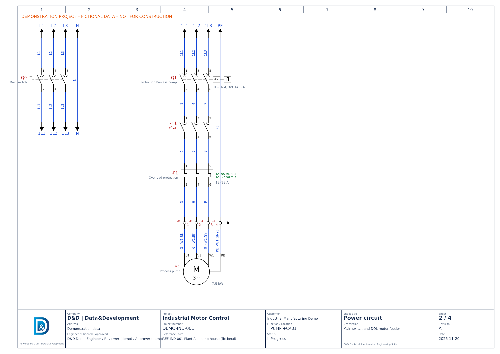
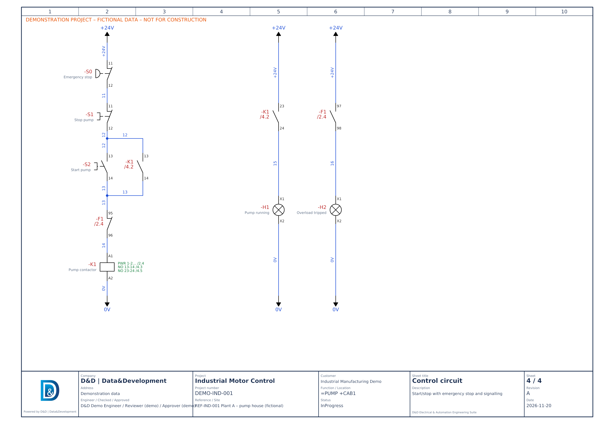
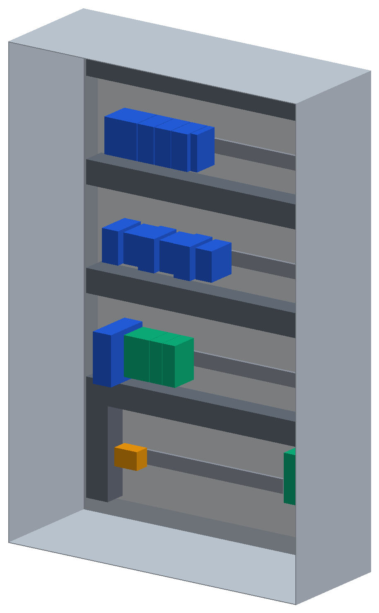
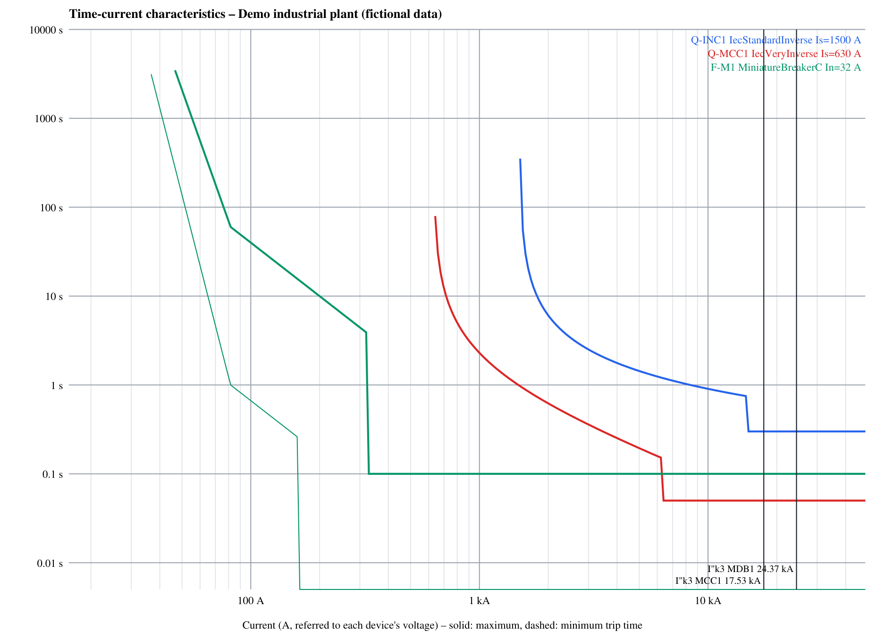

title: Manuel utilisateur
subtitle: Installation, licences et guide fonctionnel complet
product: D&D Electrical & Automation Engineering Suite
shortname: D&D Engineering Suite
tagline: One Platform. Multiple Engineering Disciplines. Unlimited Possibilities.
version_label: Version 0.5.0
edition_date: 20/11/2026
edition_label: Édition du {date}
language_label: Langue : français
author: D&D | Data&Development
author_line: Auteur et développeur : D&D | Data&Development
copyright: © 2026 D&D | Data&Development. Tous droits réservés.
powered: Powered by D&D | Data&Development
page: Page
figure: Figure
toc_title: Sommaire
keywords: CAO électrique, automatisme, automate, réseaux électriques, répartition de charge, court-circuit, 3D, BIM, IFC, jumeau numérique
---
### À propos de ce manuel

Ce manuel décrit **D&D Electrical & Automation Engineering Suite** version 0.5.0 (nom court **D&D Engineering Suite**), de l'installation et de l'activation de la licence jusqu'à la dernière fonction de chaque module. Il s'adresse aux ingénieurs en électricité, automatisme et réseaux électriques, aux dessinateurs, chefs de projet, équipes de maintenance et administrateurs de licences.

| Élément | Information |
|---|---|
| Produit | D&D Electrical & Automation Engineering Suite |
| Nom court | D&D Engineering Suite |
| Identifiant produit | DND-EAES |
| Version | 0.5.0 |
| Auteur | D&D | Data&Development |
| Développeur | D&D | Data&Development |
| Éditeur et titulaire des droits | D&D | Data&Development |
| Slogan | One Platform. Multiple Engineering Disciplines. Unlimited Possibilities. |
| Devise | One engineering object. Multiple engineering representations. One connected lifecycle. |
| Édition du manuel | 20/11/2026, français (une édition anglaise est disponible) |

### Droits d'auteur et mentions légales

© 2026 D&D | Data&Development. Tous droits réservés. Aucune partie de ce logiciel ou de cette documentation ne peut être reproduite ou diffusée sans l'autorisation écrite de D&D | Data&Development, sauf dans les limites prévues par le contrat de licence fourni avec le produit.

**Aucune certification.** Les calculs, études, vérifications et rapports sont des aides à l'ingénierie préliminaires fondées sur des méthodes documentées. Ils ne certifient pas la conformité à une norme (CEI/IEC, IEEE, NF C, EN ou autre) et ne remplacent pas la vérification par un ingénieur qualifié au regard des normes sous licence et des données des constructeurs.

**Données de démonstration.** Les projets de démonstration, clients, produits, prix, données de réseau et certificats fournis avec le logiciel sont fictifs et signalés comme données de démonstration.

**Données simulées.** Les valeurs produites par le simulateur intégré du jumeau numérique sont toujours signalées comme simulées et ne sont jamais présentées comme des mesures terrain.

**Marques.** Les noms d'organismes de normalisation, de constructeurs, de logiciels et de protocoles cités dans ce manuel (par exemple IEC, IEEE, Siemens, Rockwell Automation, Schneider Electric, Mitsubishi Electric, Omron, ABB, WAGO, Phoenix Contact, SAP, Microsoft, Windows, Anthropic, Claude, Modbus, MQTT, OPC UA) appartiennent à leurs propriétaires respectifs. Leur mention décrit une compatibilité ou une terminologie et n'implique aucun partenariat ni approbation.

### Composants tiers

La suite utilise les composants open source suivants, sous leurs propres licences : .NET (MIT), Entity Framework Core avec les fournisseurs SQLite et Npgsql (MIT / licence PostgreSQL), SkiaSharp (MIT), HelixToolkit.Wpf (MIT), Xbim.Essentials (CDDL), MQTTnet (MIT), le SDK C# d'Anthropic (MIT), ClosedXML (MIT), CommunityToolkit.Mvvm (MIT), Serilog (Apache 2.0) et les polices DejaVu (licence libre, voir `resources/Fonts/DejaVu-LICENSE.txt`).

### Conventions

- L'interface du logiciel est en anglais : les noms de menus, boutons et champs sont cités **en gras, tels qu'ils apparaissent à l'écran**, par exemple **Engineering ▸ Validate**. Les rapports et documents générés sont disponibles en anglais et en français.
- Le texte `à chasse fixe` est à saisir : commandes, noms de fichiers, adresses, repères.
- Le symbole ▸ sépare un onglet du ruban ou un menu de la commande qu'il contient.
- Les encadrés bleus contiennent des limites importantes ou des informations de sécurité.

[[PAGEBREAK]]
[[TOC]]

# Introduction

## Présentation de la suite

D&D Electrical & Automation Engineering Suite est une plateforme d'ingénierie modulaire. Elle réunit dans un seul fichier projet :

- la CAO de schémas électriques avec une connectivité réelle, des bibliothèques de symboles, la filerie, les câbles, les borniers, les E/S automate et l'implantation d'armoires ;
- les calculs d'ingénierie avec notes de calcul transparentes ;
- les études de réseaux électriques (**D&D PowerStudio**) : répartition de charge, court-circuit, sélectivité des protections et harmoniques ;
- l'ingénierie d'automatisme : instruments, boucles de régulation, alarmes, matrices causes-effets et architecture du contrôle-commande ;
- les armoires et chemins de câbles en 3D avec détection de collisions, et l'échange IFC (BIM) ;
- un jumeau numérique connecté en Modbus TCP et MQTT ;
- la génération de documentation, la gestion du cycle de vie du projet, les intégrations et un assistant d'ingénierie.

## Un objet d'ingénierie, plusieurs représentations

Chaque composant physique est un **objet d'ingénierie** doté d'une identité permanente. Le même objet apparaît comme symbole de schéma, dans la liste des équipements, l'implantation d'armoire, le modèle 3D, l'export IFC, la liste d'E/S automate, le carnet de câbles, les fiches de maintenance et de mise en service et les points du jumeau numérique. Lorsque deux représentations divergent (par exemple un repère ou une puissance différente), le logiciel signale le conflit et ne synchronise qu'après que vous avez choisi la valeur correcte.

## Modules

La suite est commercialisée par module. Le tableau présente chaque module et ses fonctions principales ; la licence détermine les modules actifs sur votre poste.

| Code | Module | Fonctions principales |
|---|---|---|
| ELEC | Ingénierie électrique | Schémas, connectivité, filerie, câbles, borniers, implantation 2D, calculs, vérification |
| AUTO | Ingénierie d'automatisme | Configuration automate, instruments, boucles, alarmes, causes-effets, architecture, schémas de boucle |
| POWER | D&D PowerStudio | Répartition de charge, court-circuit CEI 60909, sélectivité, harmoniques, calculateurs réseau |
| 3D | Ingénierie 3D | Armoires 3D, équipements, chemins de câbles, collisions, coupes, export glTF/GLB/STL |
| BIM | Ingénierie BIM | Export et import IFC4 |
| INFRA | Ingénierie d'infrastructure | Modèles et calculateurs centre de données, solaire, ferroviaire, pétrole et gaz |
| TWIN | Jumeau numérique | Valeurs en temps réel Modbus TCP, MQTT ou simulateur, alarmes et tendances |
| AI | Assistant d'ingénierie | Assistant local ou Claude, propositions confirmées et traçabilité |
| DOCS | Documentation | PDF, Excel, CSV, DXF, SVG, PNG, dossiers de remise |
| CATALOG | Catalogue d'équipements | Catalogue neutre vis-à-vis des constructeurs, approvisionnement |
| PROJECT | Gestion de projet | Cycle de vie, approbations, registres, maintenance, mise en service |
| INTEGRATION | Intégrations externes | Connecteurs ERP, GMAO et webhook |

## Par où commencer

1. Installez le logiciel (chapitre 3) et activez une licence ou la licence d'évaluation (chapitre 4).
2. Ouvrez un projet de démonstration depuis la page d'accueil (chapitre 5).
3. Suivez le tutoriel *Your first schematic*, proposé à l'ouverture de l'éditeur de schémas.
4. Utilisez ce manuel comme référence pour chaque module.

# Configuration requise

## Application de bureau

| Élément | Exigence |
|---|---|
| Système d'exploitation | Windows 10 version 2004 (build 19041) ou ultérieure, ou Windows 11, 64 bits |
| Environnement d'exécution | .NET 10 Desktop Runtime (inclus dans l'installateur autonome) |
| Processeur | 64 bits, 4 cœurs recommandés (PowerStudio et la 3D profitent d'un processeur rapide) |
| Mémoire | 8 Go minimum, 16 Go recommandés pour les grands projets |
| Affichage | 1600 × 900 ou plus ; la visionneuse 3D nécessite une carte graphique compatible DirectX |
| Disque | Environ 500 Mo pour l'application, plus vos projets |
| Réseau | Inutile pour le travail local ; nécessaire pour l'activation en ligne, le serveur de licences, les connexions Modbus/MQTT, les webhooks et l'assistant Claude |

## Outil en ligne de commande

L'outil `dnd-electrical` fonctionne sous Windows, Linux et macOS avec l'environnement .NET 10. Il permet la vérification par lots, la numérotation, les exports, les études, les exports 3D/IFC, les intégrations et la gestion des licences.

## Serveur de licences (administrateurs)

Le serveur de licences est une application ASP.NET Core qui fonctionne sous Windows ou Linux avec l'environnement ASP.NET Core .NET 10, derrière HTTPS. Il enregistre ses données dans une base SQLite.

# Installation

## Installer l'application de bureau

1. Téléchargez `DND-Electrical-Engineering-Suite-Setup.exe` auprès de D&D | Data&Development.
2. Lancez l'installateur. Windows peut demander les droits d'administrateur.
3. Lisez et acceptez le contrat de licence.
4. Choisissez le dossier d'installation. Par défaut : `C:\Program Files\DND\Engineering Suite`.
5. Choisissez les tâches facultatives : installer les projets de démonstration et créer un raccourci sur le bureau.
6. Cliquez sur **Install**, puis sur **Finish**. Vous pouvez lancer l'application immédiatement.

L'installateur associe le type de fichier `.dndx` : un double-clic sur un projet l'ouvre dans la suite. L'environnement .NET est inclus ; aucun téléchargement séparé n'est nécessaire.

## Emplacement des données

| Données | Emplacement |
|---|---|
| Paramètres (`settings.json`) | `%LOCALAPPDATA%\DND\ElectricalSuite` |
| Fichiers et état de licence | `%LOCALAPPDATA%\DND\ElectricalSuite\Licensing` |
| Secrets chiffrés (clé API de l'assistant) | `%LOCALAPPDATA%\DND\ElectricalSuite\secrets.bin` |
| Fichiers de récupération (sauvegarde automatique) | `%LOCALAPPDATA%\DND\ElectricalSuite\Recovery` |
| Journaux | `%LOCALAPPDATA%\DND\ElectricalSuite\Logs` |
| Bibliothèques de symboles personnalisées | `%LOCALAPPDATA%\DND\ElectricalSuite\Symbols` |
| Extensions (plugins) | `%LOCALAPPDATA%\DND\ElectricalSuite\Plugins` |
| Articles d'aide personnalisés | `%LOCALAPPDATA%\DND\ElectricalSuite\Documentation` |
| Projets de démonstration (option de l'installateur) | `Documents publics\DND Electrical\Demo projects` (raccourci *Demo projects* du menu Démarrer) |
| Projets de démonstration ouverts depuis la page d'accueil | `%LOCALAPPDATA%\DND\ElectricalSuite\DemoProjects` |
| Manuels utilisateur (PDF, anglais et français) | `<dossier d'installation>\Manual` (raccourcis du menu Démarrer) |
| Projets | Là où vous les enregistrez (fichiers `.dndx`), avec un dossier `.dndx.backups` à côté |

## Mise à jour

Lancez l'installateur de la nouvelle version. Les paramètres, licences, bibliothèques et projets sont conservés. Les projets créés avec une version antérieure sont mis à niveau automatiquement à leur première ouverture et sauvegarde ; conservez la copie de sauvegarde si vous devez revenir à l'ancienne version.

## Désinstallation

Utilisez **Paramètres Windows ▸ Applications ▸ D&D Electrical & Automation Engineering Suite ▸ Désinstaller**. Vos projets et le dossier de paramètres `%LOCALAPPDATA%\DND\ElectricalSuite` sont conservés. Désactivez une licence en ligne avant la désinstallation si vous souhaitez réutiliser l'activation sur un autre poste (chapitre 4).

## Installer l'outil en ligne de commande

L'outil en ligne de commande est inclus dans le dossier d'installation. Sous Linux ou macOS, un administrateur peut le publier à partir du code source :

```
dotnet publish src/DND.Electrical.Cli -c Release -o ./dnd-cli
./dnd-cli/dnd-electrical --help
```

## Compilation à partir des sources (développeurs)

Avec le SDK .NET 10 :

```
./scripts/build.sh
dotnet run --project src/DND.Electrical.App
```

`build.sh` (ou `build.ps1` sous Windows) compile la solution et exécute toutes les suites de tests. L'installateur Windows est produit avec `scripts/publish-windows.ps1` et Inno Setup (`installers/DND-Electrical-Setup.iss`).

# Licences et activation

## Principes

Chaque module fait l'objet d'une licence distincte. Une licence est un fichier signé par D&D | Data&Development avec une signature cryptographique (ECDSA P-256) ; l'application vérifie la signature hors ligne et refuse toute licence modifiée. Les licences peuvent être :

| Abonnement | Description |
|---|---|
| Mensuel / Annuel | Abonnement à durée limitée |
| Perpétuel | Droit d'utilisation permanent de la version acquise |
| Perpétuel avec maintenance | Licence permanente avec mises à jour jusqu'à la fin de la maintenance |
| Entreprise | Contrat à l'échelle de l'organisation |
| Essai / Évaluation | Évaluation à durée limitée |

| Modèle de poste | Description |
|---|---|
| Poste (device) | Liée aux postes activés (nombre maximal de postes) |
| Utilisateur nommé | Attribuée à des utilisateurs nommés |
| Flottante | Jetons simultanés empruntés au serveur de licences |

Une licence peut autoriser l'usage hors ligne ou exiger une revalidation en ligne périodique. Après l'expiration, une période de grâce s'applique ; à son terme, les projets restent consultables (lecture seule) mais les fonctions sous licence s'arrêtent. **Les données de projet ne sont jamais supprimées ni chiffrées à cause d'une licence.**

## Ouvrir la page des licences

Choisissez **Help ▸ Licensing** ou cliquez sur l'état de la licence dans la barre d'état. La page affiche :

- l'état de la licence (Valid, Grace period, Expired, Revoked, Suspended, Invalid signature, Wrong device, Clock tampered ou Not activated) ;
- l'identifiant de licence, le titulaire, l'organisation, le type d'abonnement et le modèle de poste ;
- le début de validité, l'expiration, la fin de maintenance, la politique hors ligne et la période de grâce ;
- l'identifiant de ce poste et le poste auquel la licence est liée ;
- la liste des douze modules avec *Licensed* ou *Not licensed* et leur niveau de maturité.

## Licence d'évaluation

Cliquez sur **Install evaluation licence**. La licence d'évaluation active tous les modules jusqu'au 31 décembre 2027, pour un usage d'évaluation uniquement. En ligne de commande : `dnd-electrical license evaluation`.

## Activation en ligne

1. Saisissez la **clé de licence** reçue de D&D | Data&Development (format `XXXX-XXXX-XXXX-XXXX-XXXX`).
2. Vérifiez l'**URL du serveur de licences** (fournie avec votre clé).
3. Cliquez sur **Activate**. Le serveur contrôle la clé et le nombre de postes activés, puis renvoie une licence liée à ce poste.
4. Utilisez **Refresh** pour renouveler la licence (par exemple après un renouvellement ou un changement de modules) et **Deactivate** pour libérer l'activation de ce poste.

## Activation hors ligne

Pour les postes sans accès à Internet :

1. Cliquez sur **Export activation request** et saisissez votre identifiant de licence. Un fichier de demande est créé.
2. Envoyez ce fichier à votre administrateur de licences.
3. L'administrateur crée une licence liée au poste dans le portail d'administration des licences (**Offline activation**).
4. Cliquez sur **Import licence file** et sélectionnez le fichier `.dndlic` reçu.

En ligne de commande : `dnd-electrical license request <idLicence> demande.json` puis `dnd-electrical license install licence.dndlic`.

## Licences flottantes

Avec une licence flottante, l'application emprunte un jeton au serveur de licences au démarrage, envoie un signal de présence pendant son fonctionnement et libère le jeton à la fermeture. Si tous les jetons sont utilisés, les fonctions sous licence restent indisponibles jusqu'à la libération d'un jeton.

## Lorsqu'un module n'est pas sous licence

La commande n'est pas masquée : à son ouverture, une page indique le nom et l'objet du module, la raison et la façon de l'obtenir. Le contrôle est effectué dans les moteurs eux-mêmes, de sorte qu'aucune autre voie ne permet d'utiliser la fonction. Sans le module **ELEC**, les projets s'ouvrent en **lecture seule** : vous pouvez consulter, sélectionner, déplacer la vue et zoomer, mais pas modifier.

## Protections de sécurité

- La signature de la licence est vérifiée à chaque évaluation de la licence.
- Si l'horloge du poste est reculée de plus de 24 heures avant la dernière utilisation enregistrée, les fonctions sous licence sont bloquées jusqu'au prochain rafraîchissement en ligne.
- Les licences révoquées sont détectées par les licences rafraîchies et par une liste de révocation signée.
- L'identifiant de poste est une empreinte salée de l'identifiant produit, du nom de l'ordinateur, de la plateforme et d'un identifiant d'installation aléatoire ; aucun numéro de série matériel ni donnée personnelle n'est utilisé.

## Portail d'administration des licences (administrateurs)

Le serveur de licences comprend un portail web à son adresse racine. Après connexion, les administrateurs peuvent :

- créer des clients et des organisations ;
- émettre des licences (modules, abonnement, modèle de poste, limites, validité, politique hors ligne, période de grâce) ;
- renouveler, prolonger, suspendre, réactiver ou révoquer des licences et modifier les modules ;
- consulter et libérer les activations de postes, traiter les demandes d'activation hors ligne ;
- consulter l'utilisation et le journal d'audit, et exporter un rapport CSV des licences.

Démarrez le serveur avec le chemin de la clé de signature et un mot de passe administrateur initial d'au moins 12 caractères :

```
dotnet run --project src/DND.Electrical.LicenseServer -- --Licensing:SigningKeyPath=/secure/signing-key.pem --Licensing:BootstrapAdminPassword='<mot de passe>'
```

Déployez-le derrière HTTPS. La clé privée de signature n'existe que sur le serveur ; sauvegardez la base de données et la clé séparément. L'outil `dnd-license` (`keygen`, `issue`, `verify`, `request-info`) permet l'administration hors ligne.

# Prise en main et interface

## Page d'accueil

Lorsque l'application démarre sans projet, la page d'accueil affiche :

- **New project**, **Open project…** et **Import archive…** ;
- la liste des projets récents ;
- les dix projets de démonstration (données fictives) ;
- les projets récupérables après un arrêt inattendu ;
- les liens vers le centre d'aide et le tutoriel *Getting started*.

## Fenêtre principale

- **Ruban** avec les onglets Home, Project, Drawing, Insert, Engineering, Calculation, Reports, View, Tools et Help.
- **Panneau gauche** : explorateur de projet (folios, appareils, câbles, borniers, automates, moteurs, armoires, calculs, révisions, pièces jointes), navigateur de symboles, résultats de recherche et calques.
- **Centre** : onglets de dessin ; plusieurs folios peuvent être ouverts simultanément.
- **Panneau droit** : propriétés de l'objet sélectionné.
- **Panneau inférieur** : ligne de commande, messages de vérification et journal.
- **Barre d'état** : dernier message, état grille/accrochage/orthogonal, folio actif, coordonnées du curseur (mm) et état de la licence.

## Référence du ruban

| Onglet | Commandes |
|---|---|
| Home | New, Open, Save, Save as, Close, Undo, Redo, Copy, Cut, Paste, Delete, Validate, Calculations, Drawing PDF |
| Project | New sheet, Rename, Delete sheet, Properties, New revision, Version history, Attach file, Company logo, Duplicate, Export archive, Import archive |
| Drawing | Select, Pan, Zoom all, Wire, Line, Polyline, Rectangle, Circle, Arc, Text, Dimension, Callout, Move, Copy, Rotate 90°, Mirror, Duplicate, Group, Ungroup, Align left, Align top |
| Insert | Insert selected (symbole), Symbol editor, import DXF, import Catalogue |
| Engineering | Number wires, Renumber all, Renumber devices, Sync terminals, Engineering data, Integrations, Digital twin, Automation, PowerStudio, 3D layout, Project mgmt, Validate |
| Calculation | Calculation workspace, Methodology |
| Reports | Drawing set PDF, Reports…, Handover package, DXF, SVG, PNG, JSON, XML |
| View | Grid, Snap, Object snap, Ortho, Theme, mode débutant/avancé |
| Tools | Settings, Symbol editor, Plugins, Assistant |
| Help | Help center, Getting started, Shortcuts, What's new, Licensing, About |

## Raccourcis clavier

| Raccourci | Action |
|---|---|
| Ctrl+N / Ctrl+O | Nouveau projet / Ouvrir un projet |
| Ctrl+S / Ctrl+Maj+S | Enregistrer / Enregistrer sous |
| Ctrl+Z / Ctrl+Y | Annuler / Rétablir |
| Ctrl+C / Ctrl+X / Ctrl+V | Copier / Couper / Coller |
| Ctrl+D | Dupliquer la sélection |
| Ctrl+A | Tout sélectionner |
| Ctrl+Maj+P | Palette de commandes |
| Ctrl+F | Rechercher partout |
| F1 | Centre d'aide |
| F7 / F9 / F10 | Activer ou désactiver grille / accrochage / orthogonal |
| F8 | Vérifier le projet |
| R / X | Faire pivoter / mettre en miroir le symbole en cours de placement |
| Échap | Annuler l'outil en cours |
| Maj (maintenue) | Désactiver temporairement le mode orthogonal |
| Alt (maintenue) | Désactiver temporairement l'accrochage |

## Trouver commandes et objets

- **Palette de commandes** (Ctrl+Maj+P) : tapez une partie du nom d'une commande, y compris les fenêtres des modules.
- **Rechercher partout** (Ctrl+F) : folios, appareils, fils, câbles, mnémoniques automate et articles d'aide.
- Les infobulles indiquent le rôle et le raccourci de chaque bouton.

## Thèmes et modes

**View ▸ Theme** bascule entre clair et sombre. La couleur d'accentuation se règle dans **Tools ▸ Settings**. Le *mode débutant* masque les groupes avancés du ruban (Modify, Import, Archive, échanges de folios et de données) ; le *mode avancé* affiche tout.

## Centre d'aide et tutoriels

Appuyez sur **F1** pour ouvrir le centre d'aide : articles avec recherche, méthodologie de calcul et tutoriels. Les tutoriels vous guident pas à pas et mettent en évidence l'action suivante. Les administrateurs peuvent ajouter ou remplacer des articles d'aide (enregistrés dans le dossier de documentation utilisateur) et les publier.

# Projets

## Créer un projet

1. **Home ▸ New** (Ctrl+N).
2. Choisissez un modèle (tableau ci-dessous).
3. Saisissez le numéro de projet, le nom, le client, la société, l'ingénieur et le site. Ces valeurs alimentent tous les cartouches.
4. Cliquez sur **Create**, puis sur **Save as** pour choisir le nom du fichier (`.dndx`).

| Modèle | Contenu |
|---|---|
| Blank project | Page de garde uniquement |
| Industrial installation | Distribution d'énergie et circuits de commande |
| Manufacturing plant | Puissance machine, commande et folios automate (profil orienté CEI 60204-1) |
| Oil and Gas | MCC, interface ESD, instrumentation et registre des zones dangereuses |
| Water treatment | Stations de pompage, instrumentation et E/S automate |
| Power distribution | Transformateur, TGBT et départs |
| Building installation | Tableaux, éclairage et prises (profil NF C 15-100) |
| HVAC systems | Ventilateurs, pompes, compresseurs, variateurs et interface GTB |
| Industrial automation | Projet centré sur l'automate avec folios d'E/S |
| Renewable energy | Côté alternatif PV/stockage |
| Data center | Schéma unifilaire, onduleurs A/B, PDU, EPMS/GTB |
| Solar PV plant | Chaînes, boîtes de jonction, onduleurs, collecte AC, raccordement réseau, supervision |
| Railway station / depot | Distribution BT de gare, alimentation signalisation, éclairage des quais, interfaces SCADA |

Les modèles fixent la tension nominale, le schéma des liaisons à la terre et le profil normatif (CEI 60364, CEI 60204-1 ou NF C 15-100) utilisés par les calculs.

## Propriétés du projet

**Project ▸ Properties** modifie les données du projet, l'état (Draft, In progress, For review, Approved, For construction, As built, Archived), le secteur, la tension nominale et le schéma des liaisons à la terre. **Project ▸ Company logo** définit le logo utilisé dans les cartouches et les rapports.

## Enregistrement, sauvegardes et verrouillage

- L'enregistrement est **atomique** : le projet est écrit dans un fichier temporaire qui remplace ensuite l'original.
- Avant chaque enregistrement, la version précédente est copiée dans `<projet>.dndx.backups` (les 10 dernières par défaut). **Project ▸ Version history** permet d'en restaurer une.
- Les modifications non enregistrées sont écrites dans une copie de récupération toutes les quelques minutes (jamais dans votre fichier). Après un incident, la page d'accueil propose de la récupérer.
- L'ouverture d'un projet crée un fichier de verrou. Si quelqu'un d'autre l'a ouvert, vous voyez qui et depuis quand, et ne pouvez l'ouvrir qu'en forçant explicitement le verrou.

## Révisions, archives et pièces jointes

- **Project ▸ New revision** crée une révision (code, description, auteur) ; tous les folios prennent le nouvel indice.
- **Export archive** crée un paquet `.dndpkg` ; **Import archive** contrôle le paquet avant de l'extraire.
- **Duplicate** copie le projet avec une nouvelle identité et un nouveau numéro.
- **Attach file** enregistre fiches techniques, photos et PDF (jusqu'à 100 Mo chacun) dans le projet.
- Toute action significative est consignée dans le **journal d'audit** du projet.

# Dessin de schémas

## Folios

Les folios utilisent les formats A0 à A4 (A3 paysage par défaut) avec cadre, colonnes de repérage numérotées et cartouche. Les champs tels que `{PROJECT.NAME}`, `{PROJECT.NUMBER}` ou `{SHEET.NUMBER}` sont renseignés automatiquement. Utilisez **Project ▸ New sheet**, **Rename** et **Delete sheet** pour les gérer.



## Outils de dessin

| Outil | Commande | Utilisation |
|---|---|---|
| Ligne | `L` | Cliquez le début et la fin ; continue à partir du dernier point |
| Polyligne | `PL` | Cliquez les points, Entrée pour terminer, `C` pour fermer |
| Rectangle | `REC` | Deux coins |
| Cercle | `C` | Centre et rayon |
| Arc | `A` | Début, point sur l'arc, fin |
| Texte | `T` | Point d'insertion, puis le texte |
| Cote | `DIM` | Deux points et la position de la ligne de cote |
| Repère (callout) | `LE` | Pointe de flèche, points de pliage, Entrée, puis le texte |

## Saisie précise

Tapez les coordonnées dans la ligne de commande : `100,50` (absolu), `@20,0` (relatif) ou `@50<45` (polaire : distance et angle).

## Accrochage

Accrochage à la grille (5 mm par défaut), accrochage aux objets (extrémités, milieux, centres, bornes) et mode orthogonal (horizontal et vertical). Maintenez **Maj** pour désactiver temporairement le mode orthogonal et **Alt** pour désactiver l'accrochage.

## Sélection et modification

Cliquez pour sélectionner ; Maj ajoute, Ctrl inverse. Faites glisser de gauche à droite pour une sélection *fenêtre* (objets entièrement inclus) et de droite à gauche pour une sélection *capture*. Faites glisser un objet sélectionné pour le déplacer. Rotation, miroir, alignement, groupement, dégroupement, copier, coller et dupliquer se trouvent dans les onglets Home et Drawing. Toute opération peut être annulée.

## Calques

Les entités sont placées sur des calques (WIRES, SYMBOLS, TAGS, ANNOTATIONS…). Les calques peuvent être masqués, verrouillés ou exclus de l'impression dans le panneau Layers.

# Symboles

## Navigateur de symboles

Le navigateur liste tous les symboles par catégorie avec un aperçu. Recherchez par nom, identifiant ou mot-clé (mots-clés anglais et français). Double-cliquez sur un symbole pour le placer : **R** le fait pivoter, **X** le met en miroir, **Échap** arrête.

## Bibliothèque intégrée

La bibliothèque *D&D IEC Basic* contient 46 symboles originaux de style CEI 60617 : disjoncteurs (1 à 4 pôles), disjoncteurs moteur, fusibles, différentiels, interrupteurs-sectionneurs, bobines et contacts principaux de contacteurs, contacts auxiliaires (NO, NF, inverseur), relais thermiques, moteurs, transformateurs, alimentations, variateurs, démarreurs progressifs, boutons-poussoirs, arrêts d'urgence, commutateurs et fins de course, détecteurs de proximité, photoélectriques et de niveau, transmetteurs de température et de pression, voyants, avertisseurs sonores, électrovannes, résistances chauffantes, prises de courant, bornes, connecteurs, renvois de potentiel, points de coupure et voies d'E/S automate.

## Comportement électrique des symboles

Chaque symbole déclare un **rôle** (appareil autonome, fonction principale telle qu'une bobine, contact enfant, borne, renvoi de potentiel, point de coupure, voie automate, connecteur), ses **bornes** avec leur direction de sortie, ses **liaisons internes** et un **préfixe de repère** par défaut.

## Symboles personnalisés

1. **Tools ▸ Symbol editor**.
2. Partez de zéro ou dupliquez un symbole intégré (les bibliothèques intégrées sont en lecture seule).
3. Dessinez le graphisme avec la ligne de commande (L, PL, C, A, REC, T) ; l'origine est le point d'insertion ; utilisez la grille de 2,5 mm.
4. Ajoutez les bornes et attributs, définissez le rôle et le préfixe de repère.
5. Enregistrez dans une bibliothèque personnalisée. Chaque enregistrement incrémente la version du symbole.

Les bibliothèques sont des fichiers JSON (`*.dndsym.json`) importables et exportables. Les projets conservent une copie de chaque symbole utilisé et s'ouvrent donc correctement sur d'autres postes.

# Connexions électriques

## Tracer des fils

Choisissez **Wire** (`W`). Cliquez sur une borne pour commencer ; les bornes sont mises en évidence par une croix. Cliquez dans le vide pour ajouter des points de pliage et cliquez sur une autre borne, une jonction ou un fil existant pour terminer. Les tracés sont orthogonaux et respectent la direction de sortie des bornes. Cliquer au milieu d'un fil existant insère une **jonction** (dérivation en T).

## Connectivité

Un fil enregistre *ce qu'il* relie (symbole et borne, ou jonction). Déplacer un symbole entraîne ses fils. Deux symboles qui se touchent simplement ne sont **pas** reliés.

Les **potentiels** (groupes équipotentiels) sont calculés à partir des fils, des jonctions, des liaisons internes des symboles, des renvois de potentiel de même nom (L1, N, PE, +24V, 0V…) et des points de coupure de même nom (liaisons entre folios). Les points de coupure affichent l'emplacement de leurs correspondants, par exemple `/5.3`.

## Propriétés des fils

Numéro, couleur, section, type, longueur physique et conducteur de câble se modifient dans le panneau Properties. Si un potentiel relie deux alimentations nommées différentes (par exemple L1 et N), la vérification signale un court-circuit.

# Numérotation et renvois

## Repères d'appareils

Les nouveaux appareils reçoivent le repère libre suivant au format du projet (par défaut `-{PREFIX}{N}`, par exemple `-K3`). Les préfixes proviennent du symbole : Q disjoncteurs, K contacteurs et relais, F protections, M moteurs, S commutateurs, B capteurs, H voyants, X bornes, T transformateurs et variateurs, G alimentations, Y vannes. **Engineering ▸ Renumber devices** renumérote les repères non verrouillés dans l'ordre d'apparition ; les repères saisis manuellement sont verrouillés.

## Numéros de fils

**Engineering ▸ Number wires** numérote les fils non numérotés ; **Renumber all** renumérote tout, sauf les numéros verrouillés.

- *Par potentiel* (par défaut) : tous les fils d'un potentiel partagent un numéro.
- *Par fil* : chaque fil est numéroté individuellement.
- Les fils des potentiels nommés prennent le nom du potentiel (L1, +24V…).

Jetons de format : `{GSEQ}` séquence du projet, `{SHEET}`, `{COL}`, `{SEQ}` séquence dans le folio, avec remplissage de zéros facultatif comme `{GSEQ:000}`. La numérotation peut être annulée.

## Appareils et renvois

Un **appareil** est un composant physique doté d'un repère. Il peut être représenté par plusieurs symboles : un contacteur possède une bobine (fonction principale) et des contacts (enfants) sur différents folios avec le même repère. Les contacts affichent l'emplacement de leur bobine (par exemple `/4.2` = folio 4, colonne 2) et les bobines affichent un **miroir de contacts** listant chaque contact avec ses bornes et son emplacement.



# Composants, catalogue et nomenclature

## Propriétés des appareils

Sélectionnez un symbole pour modifier son repère, sa fonction, sa localisation, le constructeur, la référence et les propriétés techniques (calibre, tension, réglages, zone dangereuse et marquage Ex le cas échéant). Les numéros de bornes des contacts peuvent être modifiés par symbole.

## Catalogue

Choisissez une référence du catalogue dans le champ **Part number** : le constructeur est renseigné, les dimensions du produit sont utilisées par l'implantation d'armoire et le modèle 3D, et les prix alimentent la nomenclature. **Insert ▸ Catalogue** importe des fichiers CSV ou Excel avec les colonnes Manufacturer, PartNumber, Description, Category, UnitPrice, Currency, Supplier, Width, Height, Depth. Les produits importés sont marqués comme données de catalogue vérifiées ; les produits de démonstration fournis sont marqués fictifs et signalés par la règle VAL022. Le logiciel n'invente jamais de caractéristiques de constructeur.

## Nomenclature et approvisionnement

La nomenclature est générée à partir des appareils, des bornes, des accessoires d'armoire (enveloppes, rails DIN et goulottes en mètres) et des câbles (en mètres), regroupés par constructeur et référence avec quantités, prix, totaux et état d'approvisionnement. Dans **Engineering data ▸ Procurement status**, définissez l'état par référence (non commandé, demandé, devisé, commandé, livré, installé, annulé), le fournisseur et le bon de commande.

# Câbles et borniers

## Câbles

Créez les câbles dans **Engineering data ▸ Add cable** (type, nombre de conducteurs, section, longueur, origine, destination, diamètre extérieur). Les conducteurs reçoivent un marquage de style CEI 60445 (BN, BK, GY, BU, GNYE) ou des numéros. Affectez un fil à un câble avec le champ **Cable** des propriétés du fil ; le conducteur libre suivant est utilisé (le conducteur de protection en dernier). Le schéma affiche le conducteur à côté du numéro de fil, par exemple `-W1:BN`. Le diamètre extérieur est utilisé pour le taux de remplissage des chemins de câbles (chapitre 15).

## Borniers

Placez les symboles de borne avec le repère du bornier (par exemple `-X1`) et un numéro de borne. **Engineering ▸ Sync terminals** crée les définitions de borniers (numéro de borne, type, étage, groupe de pontage). Le **plan de bornier** est généré à partir du câblage réel : raccordements côté armoire et côté terrain, numéros de fils et pontages.

## Rapports

Le **carnet de câbles** liste les conducteurs utilisés et de réserve ; le **rapport de raccordement des câbles** liste conducteur, fil et bornes de départ et d'arrivée ; la **liste de filerie** liste chaque connexion.

# Configuration des automates

## Stations et modules

Ouvrez **Engineering ▸ Engineering data ▸ PLC configuration**. Créez une station (repère, nom, profil d'adressage, adresse IP) et ajoutez des modules génériques : CPU, alimentation, DI 8/16, DO 8/16, sorties relais, AI 4/8, AO 4, communication et coupleur d'E/S déportées.

| Profil d'adressage | Exemple d'entrée TOR |
|---|---|
| Generic IEC 61131-3 | `%IX0.0` |
| Siemens-style | `%I0.0` |
| Rockwell-style | `Local:1:I.Data.0` |
| Schneider-style | `%I0.1.0` |
| Mitsubishi-style | `X000` (octal) |
| Omron-style | `CIO 0.00` |
| CODESYS-based (ABB, WAGO, Phoenix Contact) | `%IX0.0` |

> Les profils d'adressage sont des modèles, pas des catalogues de constructeurs, et la suite n'échange pas de données avec les logiciels de programmation des constructeurs. Vérifiez les adresses par rapport à votre configuration matérielle.

## Lier les voies aux schémas

Placez les symboles de voie automate (DI, DO, AI, AO) sur les schémas et choisissez la voie dans le champ **Channel** de leurs propriétés. Le symbole affiche l'adresse et le mnémonique ; la liste d'E/S indique l'emplacement sur le schéma, l'appareil de terrain et la borne. Les instruments sont affectés aux voies depuis la fenêtre Automation (chapitre 18).

# Implantation d'armoire (2D)

1. **Engineering data ▸ Cabinet layout ▸ New cabinet** : largeur, hauteur et profondeur de l'enveloppe ; la plaque de montage en est déduite.
2. Ajoutez des **rails DIN** et des **goulottes**.
3. **Place device** par repère : l'appareil est placé à la première position libre d'un rail, centré sur celui-ci, avec les dimensions de son produit de catalogue.
4. Les appareils de porte (voyants, boutons-poussoirs) sont enregistrés avec la face *porte*.

La vérification d'implantation signale les éléments hors de la plaque ou de la porte, les collisions sur la plaque et sur la porte, les dégagements insuffisants et les appareils placés deux fois. Le taux d'occupation et la longueur de rail libre figurent dans le rapport d'armoire. Les éléments d'armoire sont liés aux appareils du schéma : renommer un appareil met à jour l'implantation.

# Implantation 3D et BIM

## Ouvrir la fenêtre 3D

Choisissez **Engineering ▸ 3D layout** (module 3D). Si un appareil est sélectionné dans le schéma, la fenêtre s'ouvre sur sa représentation 3D.

## Générer une armoire en 3D

Sélectionnez l'armoire et cliquez sur **Generate 3D from 2D layout**. La suite construit l'enveloppe (fond, côtés, toit, fond inférieur, porte), la plaque de montage, les rails DIN, les goulottes et les appareils avec les mêmes identités que l'implantation 2D. Les appareils sur rail reposent sur le rail ; les appareils de porte sont placés derrière la porte. Une détection de collisions s'exécute immédiatement.



## Implantations de site, équipements et chemins de câbles

- **New plant layout…** crée une implantation vide (local, zone d'usine, réseau de chemins de câbles).
- **Add equipment…** avec la syntaxe `REPÈRE; L×P×H; X,Y,Z` (millimètres, point central), par exemple `EQ1; 800×600×2000; 400,300,1000`. Si le repère existe dans le projet, l'équipement est lié à cet appareil.
- **Add tray route…** avec `REPÈRE; L×H; x,y,z / x,y,z / …`, par exemple `TR-01; 300×60; 0,0,2500 / 4000,0,2500`. Les câbles dont le champ cheminement contient le repère du chemin y sont affectés.
- **Tray fill** compare la somme des sections des câbles (π/4 × diamètre extérieur²) avec la section du chemin et le taux limite (40 % par défaut, réglable par chemin). Les câbles sans diamètre extérieur sont listés au lieu d'être estimés.

## Vérifications

- **Check clashes** : interférences entre solides et dégagements insuffisants (dégagement des appareils de l'armoire ou dégagement propre à un objet). Les jonctions de chemins et les câbles posés dans les chemins ne sont pas signalés.
- **Check 2D/3D sync** : liste les objets absents de la 3D, supprimés ou modifiés dans l'implantation 2D, les objets d'ingénierie supprimés et les écarts de repère. **Regenerate from 2D** remplace les objets générés et conserve ceux que vous avez ajoutés.

## Navigation et analyse

Faites pivoter avec le bouton droit de la souris, déplacez avec le bouton central et zoomez avec la molette ; le cube de vue donne les vues standard. Cliquez sur un objet pour le sélectionner. **Enclosure** masque parois et porte ; **Explode** éclate les objets ; **Section** coupe le modèle selon X, Y ou Z à la position choisie et trace le contour de coupe. **Measure to** indique la distance libre et la distance entre centres de l'objet sélectionné et d'un autre. **Show in schematic** ouvre le folio de l'appareil sélectionné. **Move…** déplace un objet de `dx,dy,dz` ; pour les objets générés, vous pouvez confirmer le report du déplacement dans l'implantation 2D. **Delete** supprime les objets que vous avez ajoutés (les objets générés se suppriment dans leur source).

## Export et IFC

- **GLB / glTF / STL** : exports 3D (glTF en mètres, axe Y vertical, identités d'ingénierie dans les données des nœuds ; STL en millimètres).
- **IFC…** (module BIM) : export IFC4 avec projet, site, bâtiment et niveau, classes électriques IFC (tableaux, appareils de protection et de commande, moteurs, supports de câbles, capteurs) et identité d'ingénierie dans le jeu de propriétés `Pset_DnD_EngineeringObject`.
- **Import IFC…** : importe le contexte bâtiment ou site ; les éléments dont le corps est une extrusion rectangulaire sont convertis, les autres sont comptés et signalés.

> L'échange STEP et IGES n'est pas disponible (il nécessite un noyau géométrique externe). La géométrie IFC importée se limite aux corps parallélépipédiques.

# Calculs

## Espace de calcul

Ouvrez **Calculation ▸ Calculation workspace**. Choisissez un calculateur, saisissez les valeurs (utilisez le point comme séparateur décimal), cliquez sur **Calculate** puis **Store** pour enregistrer le résultat dans le projet. Chaque résultat présente les données d'entrée, les formules avec valeurs, les étapes, les résultats avec unités, les vérifications, hypothèses, avertissements, le profil normatif et un statut (Pass, Warning, Fail, Informational). Les résultats enregistrés figurent dans la note de calcul.

| Calculateur | Méthode | Module |
|---|---|---|
| Courant à partir de la puissance | I = P/(k·U·cos φ·η) | ELEC |
| Puissances (P, Q, S) | S = k·U·I | ELEC |
| Facteur de puissance | cos φ = P/S | ELEC |
| Chute de tension | CEI 60364-5-52 annexe G | ELEC |
| Dimensionnement des câbles | Iz avec k1·k2, coordination avec la protection, chute de tension | ELEC |
| Choix du disjoncteur | Ib ≤ In ≤ Iz, Icu ≥ Ik | ELEC |
| Longueur maximale en TN | Lmax = 0,8·U0·Sph/(ρ(1+m)·Ia) | ELEC |
| Éclairage | Méthode des flux N = E·A/(Φ·UF·MF) | ELEC |
| Redondance des onduleurs | N, N+1, N+2, 2N, 2N+1 | ELEC |
| Autonomie des batteries d'onduleur | Méthode énergétique (préliminaire) | ELEC |
| PUE | Énergie du site / énergie informatique | ELEC |
| Dimensionnement des chaînes PV | Voc/Vmp corrigés en température comparés aux limites de l'onduleur | ELEC |
| Courant de court-circuit (radial) | CEI 60909 simplifiée | POWER |
| Dimensionnement du transformateur | S = P·ks/cos φ·(1 + réserve) | POWER |
| Démarrage moteur | In et courant de démarrage selon la méthode, chute de tension | POWER |
| Bilan de puissance du projet | À partir de la liste des charges et des moteurs | POWER |
| Équilibrage des phases | Charges monophasées | POWER |
| Compensation de l'énergie réactive | Qc = P·(tan φ1 − tan φ2), résonance h = √(Sk/Qc) | POWER |
| Dimensionnement du groupe électrogène | Charge permanente et chute de tension au démarrage moteur | POWER |
| Résistance d'un piquet de terre | Formule de Dwight | POWER |
| Résistance d'un maillage de terre | IEEE Std 80 (Sverak) | POWER |
| Tensions de contact et de pas admissibles | IEEE Std 80, 50 ou 70 kg | POWER |

> Les résultats sont des calculs d'ingénierie préliminaires et doivent être vérifiés par un ingénieur qualifié. Les facteurs d'utilisation, réactances des alternateurs, données de batteries et données des modules PV doivent provenir des constructeurs.

## Résumé de la méthodologie

- **Chute de tension** : u = b·(ρ1·L/S·cos φ + λ·L·sin φ)·Ib, Δu = 100·u/U0 ; b = 1 (triphasé) ou 2 (monophasé) ; ρ1 = 0,0225 Ω·mm²/m (cuivre) ou 0,036 (aluminium) ; λ = 0,08 mΩ/m.
- **Dimensionnement des câbles** : k1 = √((θmax − θa)/(θmax − 30)) ; k2 selon le tableau de groupement ; Ib ≤ In ≤ Iz et I2 ≤ 1,45·Iz ; cuivre, méthodes C et E (données transcrites de la CEI 60364-5-52, à vérifier sur votre exemplaire sous licence).
- **Court-circuit radial** : ZQ = c·Un²/S"kQ, ZT corrigée par KT = 0,95·cmax/(1 + 0,6·xT), I"k3 = c·Un/(√3·|Zk|), ip = κ·√2·I"k3.
- **Maillage de terre** : Rg = ρ·[1/LT + 1/√(20A)·(1 + 1/(1 + h·√(20/A)))].
- **Tensions de contact et de pas** : Econtact = (1000 + 1,5·Cs·ρs)·k/√ts, Epas = (1000 + 6·Cs·ρs)·k/√ts, k = 0,116 (50 kg) ou 0,157 (70 kg).
- **Chaînes PV** : V(T) = V_STC·(1 + β·(T − 25)) ; le nombre maximal de modules est limité par la tension maximale de l'onduleur et la plage MPPT.

# D&D PowerStudio

## Ouvrir PowerStudio

Choisissez **Engineering ▸ PowerStudio** (module POWER). Le sélecteur liste les réseaux enregistrés dans le projet.

| Commande | Rôle |
|---|---|
| New… | Réseau vide avec un jeu de barres 20 kV et une alimentation réseau |
| Build from project… | Réseau créé à partir de la liste des charges : alimentation, transformateur (vous saisissez sa puissance), TGBT et un jeu de barres par tableau. Les données provisoires sont listées dans les constats et doivent être remplacées |
| Demo network | Réseau industriel fictif pour la formation |
| IEEE 14-bus | Réseau de référence public utilisé pour la validation |
| Import… / Export… | Fichiers JSON de réseau |
| Save | Enregistre le réseau dans le projet (les études l'enregistrent aussi) |
| Delete selected element | Supprime la ligne sélectionnée |

## Données du réseau

Modifiez les tableaux (bouton **Add** dans chaque onglet) :

| Élément | Données principales |
|---|---|
| Buses (jeux de barres) | Identifiant, nom, tension nominale (kV), limites de tension (pu) |
| Utility feeders (alimentations réseau) | Jeu de barres, S"k max et min (MVA), R/X, consigne de tension, rapport Z0/Z1, facteur c facultatif |
| Transformers | Jeux de barres HT et BT, puissance (MVA), uk (%), pertes en charge (kW), prise, couplage (Dyn11, YNyn0, YNd5, Yd11…) |
| Lines / cables | Jeux de barres d'origine et d'arrivée, longueur (km), R, X (Ω/km), B (µS/km), R0/X0, circuits en parallèle, courant admissible (A) |
| Loads (charges) | Jeu de barres, P (MW), Q (Mvar) ; une puissance P négative représente une production, par exemple des onduleurs PV |
| Generators | Jeu de barres, P, consigne de tension, limites de Q, puissance, x"d, R/X, facteur de puissance assigné, neutre à la terre, X0, en service |
| Shunts / PFC | Jeu de barres, Q (Mvar ; positif = condensateur, négatif = réactance) |
| Protection devices | Jeu de barres, protection amont, courbe, seuil, TMS, temps constant, élément instantané, points constructeur |

Avant chaque étude, les données sont contrôlées : jeux de barres inconnus, données manquantes, transformateurs incohérents et îlots sans source sont listés et l'étude ne démarre pas.

## Répartition de charge

**Load flow** exécute une répartition de charge par la méthode de Newton–Raphson. Les charges sont à puissance constante ; les générateurs régulent leur tension dans leurs limites de puissance réactive (un générateur qui atteint une limite devient un nœud PQ et un message s'affiche). Résultats : tensions des jeux de barres (pu et kV), angles, productions et charges ; transits (P, Q), courants, taux de charge (%) et pertes des branches. Les constats listent les dépassements de tension et les surcharges.

## Court-circuit (méthode CEI 60909)

**Short circuit (IEC 60909)** calcule, pour chaque jeu de barres : courant de court-circuit triphasé maximal et minimal I"k3, courant de crête ip (méthode B), puissance de court-circuit S"k, R/X, courant biphasé I"k2 et courant phase-terre I"k1. Les impédances d'alimentation utilisent le facteur c de leur niveau de tension, les transformateurs le facteur KT, les générateurs le facteur KG ; les charges, capacités de lignes et shunts sont négligés. Les défauts à la terre utilisent le réseau homopolaire construit à partir des couplages des transformateurs ; un jeu de barres sans chemin de retour par la terre affiche *no earth path*.

> Les contributions des moteurs asynchrones, les composantes amorties (Ib, Ik, Ith) et l'énergie d'arc électrique ne sont pas calculées.

## Sélectivité des protections

Renseignez le champ **UpstreamId** de chaque protection pour définir la chaîne de sélectivité, puis cliquez sur **Protection coordination**. Pour chaque paire, l'écart entre le temps de déclenchement minimal de la protection amont et le temps maximal de la protection aval est évalué du seuil aval jusqu'au courant de défaut maximal au jeu de barres aval, puis comparé à l'échelon de sélectivité (0,3 s par défaut). Lorsque les deux protections sont instantanées au même courant, la sélectivité ne peut pas être démontrée par les courbes et les tableaux de sélectivité des constructeurs sont nécessaires.

| Courbe | Caractéristique |
|---|---|
| CEI inverse normale / très inverse / extrêmement inverse / inverse longue | t = TMS·k/((I/Is)^α − 1), constant au-delà de 20 × Is |
| Temps constant | Temps fixe au-dessus du seuil |
| Disjoncteurs modulaires B, C, D | Bande issue des valeurs conventionnelles CEI 60898-1 (1,13 In, 1,45 In, 2,55 In, instantané 3–5, 5–10, 10–20 In) |
| Définie par l'utilisateur | Points temps-courant du constructeur (temps minimal et maximal) |

L'onglet **Time-current chart** affiche les courbes (trait plein = temps maximal, pointillé = temps minimal) et les courants de défaut. **Export TCC (SVG)** enregistre le graphique.



## Analyse harmonique

**Harmonic scan** calcule l'impédance vue à chaque jeu de barres du rang 1 au rang 50 et liste les résonances parallèles (rang et fréquence). Avec des sources d'harmoniques (spectre de courant en % du fondamental, issu de mesures ou de données constructeur), la distorsion de tension de chaque rang et le THDv sont calculés.

## Rapports

L'onglet **Report** affiche le rapport de répartition de charge ou de court-circuit avec les hypothèses et l'avertissement ; **Export report…** l'enregistre en fichier texte. En ligne de commande : `dnd-electrical power <réseau.json | projet.dndx | sample:ieee14 | sample:demo> --study lf|sc|prot|harm|all`.

# Automatisme

Choisissez **Engineering ▸ Automation** (module AUTO).

## Instruments

L'onglet **Instruments** constitue la liste des instruments. **Add instrument…** crée un instrument à partir de son repère (la grandeur mesurée est proposée d'après la première lettre : P pression, T température, L niveau, F débit, A analyse). Modifiez la description, la grandeur, la fonction (transmetteur, contact, indicateur, régulateur, vanne de régulation, vanne tout-ou-rien, analyseur, détecteur, actionneur), le signal (4–20 mA, HART, 0–10 V, 24 V CC, NAMUR, bus de terrain, thermocouple, sonde à résistance), l'étendue et l'unité, la zone, la ligne de procédé, la boîte de jonction, la zone dangereuse, le marquage Ex, le constructeur, le modèle, l'état et la date d'étalonnage.

> Les zones dangereuses et marquages Ex sont enregistrés tels que saisis à partir des certificats. Le logiciel ne détermine jamais les zones ni l'aptitude des matériels.

**Assign PLC I/O…** raccorde l'instrument sélectionné à une voie (`<repère station> <adresse>`, une voie libre du bon type est proposée). L'affectation est refusée si le type de signal (analogique/TOR) ou le sens (entrée/sortie) ne correspond pas, ou si la voie est occupée.

**Propose alarms…** crée des propositions d'alarmes à des fractions de l'étendue que vous saisissez selon la philosophie d'alarmes du projet (LL, L, H, HH) ; la liste est soumise à confirmation avant ajout.

## Boucles de régulation

Ajoutez des boucles (PID, tout-ou-rien, cascade, rapport, verrouillage, séquence, surveillance) avec mesure, organe final (instrument ou appareil électrique), régulateur, consigne et réglages. **Generate loop diagram** crée ou régénère un folio *Loop diagram <repère>* présentant les instruments de terrain, la boîte de jonction et les voies du système de contrôle à partir des données.

## Alarmes

La base d'alarmes contient le repère, l'instrument ou l'appareil source, le type (HH, H, L, LL, écart, vitesse de variation, TOR, défaut), la consigne, l'hystérésis, la temporisation, la priorité, la classe, le message, la conséquence et l'action de l'opérateur.

## Matrices causes-effets

Créez une matrice, ajoutez des causes (`repère; description; condition`) et des effets (`repère d'appareil ou d'instrument; description; action`). Cliquez sur une cellule pour placer ou retirer une marque. Cochez des causes dans la colonne de gauche pour vérifier quels effets la logique documentée déclenche ; les cellules déclenchées sont mises en évidence. Il s'agit d'une vérification documentaire : rien n'est envoyé aux équipements.

## Architecture du contrôle-commande

Décrivez serveurs SCADA, IHM, stations d'ingénierie, historiens, automates, E/S déportées, variateurs, commutateurs, pare-feux, passerelles, routeurs, RTU, IED, capteurs et liaisons cloud avec réseau, zone, adresse IP, nœud amont, protocole et redondance. **Import PLC stations** ajoute les stations automates du projet.

## Règles de vérification de l'automatisme

| Règle | Contrôle |
|---|---|
| AUT001 | Repères d'instruments uniques ; instruments analogiques avec étendue et unité valides |
| AUT002 | Consignes d'alarme dans l'étendue, ordre LL < L < H < HH, repères d'alarmes uniques |
| AUT003 | Instruments affectés à des voies automate compatibles |
| AUT004 | Boucles avec mesure et organe final |
| AUT005 | Références causes-effets vers des objets existants ; causes associées à des effets |
| AUT006 | Adresses IPv4 valides et uniques par réseau, sans boucle de connexion |
| AUT007 | Marquage Ex enregistré pour les matériels en zone dangereuse |

# Jumeau numérique

Choisissez **Engineering ▸ Digital twin** (module TWIN).

## Points

**Add point…** crée un point ; si le repère est celui d'un instrument ou d'un appareil, le point y est lié. **Create simulated points from instruments** crée des points simulés pour tous les instruments analogiques. Modifiez la source, le point d'accès, l'adresse, le facteur d'échelle, le décalage et l'unité dans le tableau.

| Source | Point d'accès | Adresse |
|---|---|---|
| Modbus TCP | `hôte:port/unité` (port 502 et unité 1 par défaut) | `HR`, `IR`, `CO` ou `DI` + `:décalage` + type facultatif `i16`, `u16`, `f32`, `f32sw`, par exemple `HR:100:f32` |
| MQTT | `hôte:port` (1883 par défaut) | Sujet (topic) ; la charge utile est un nombre ou un JSON avec un champ `value` |
| Simulateur | aucun | Minimum, maximum et période |
| OPC UA | Non disponible dans cette version | |

Valeur affichée = valeur brute × facteur d'échelle + décalage.

## Fonctionnement

Réglez l'intervalle et cliquez sur **Start** ; **Stop** arrête l'acquisition. Le tableau affiche la valeur, l'unité, la qualité (Good, Stale, Bad, NotConnected), l'heure, la source, un indicateur *Simulated* et le texte d'erreur. **Active alarms** évalue les consignes d'alarme du projet avec hystérésis. Sélectionnez un point pour afficher sa tendance.

> Dès qu'une valeur affichée provient du simulateur, un bandeau orange **SIMULATED DATA** s'affiche et les alarmes simulées sont marquées [SIMULATED].

# Gestion de projet et objets d'ingénierie

Choisissez **Engineering ▸ Project mgmt** (module PROJECT).

## Cycle de vie et équipe

Définissez la **phase du cycle de vie** (avant-projet, études préliminaires, études détaillées, vérification, approvisionnement, construction, mise en service, exploitation, maintenance). Ajoutez les **membres** avec leur discipline et leur rôle (lecteur, ingénieur, ingénieur principal, approbateur, chef de projet, administrateur).

## Tâches, jalons, anomalies et documents

Les tâches ont un responsable, une discipline, une phase, une échéance, un état et un objet d'ingénierie facultatif. Les jalons ont une phase, une échéance et une date de réalisation. Le **registre des anomalies** numérote automatiquement les anomalies avec gravité, état, responsable, objet lié et résolution. Le **registre documentaire** liste numéro, titre, nature, révision, état et date d'émission.

## Approbations

**Request approval…** soumet la révision courante à un approbateur. **Approve…** et **Reject…** enregistrent la décision avec un commentaire. Les décisions exigent le rôle d'approbateur, de chef de projet ou d'administrateur et ne peuvent pas être prises par le demandeur (principe des quatre yeux) ; votre nom d'utilisateur provient de **Tools ▸ Settings**. Les décisions sont définitives et tracées.

## Maintenance et mise en service

Sélectionnez un objet d'ingénierie en haut de la fenêtre, puis ajoutez des fiches de **maintenance** (nature, description, technicien, prochaine échéance) ou des essais de **mise en service** (essai, résultat, valeur mesurée, date, remarques).

## Objets d'ingénierie et conflits

L'onglet **Engineering objects** liste toutes les représentations de l'objet sélectionné (symboles du schéma, moteur, élément d'armoire, voies automate, câbles, charges, produit de catalogue, objets 3D, points du jumeau, calculs, maintenance et mise en service). **Detect conflicts** compare repères, puissances assignées, références et dimensions entre représentations. **Synchronise selected…** demande quelle représentation fait foi et applique sa valeur après confirmation ; chaque synchronisation est consignée dans le journal d'audit.

# Vérification

**Engineering ▸ Validate** (F8) exécute les règles et liste erreurs, avertissements et informations avec l'emplacement (`/folio.colonne`) et une correction suggérée. Double-cliquez sur un message pour ouvrir le folio et sélectionner l'objet. La vérification ne modifie jamais la conception ; les corrections proposées (numéroter les fils, synchroniser les borniers, renuméroter les appareils) ne s'exécutent qu'après confirmation. Chaque exécution est enregistrée dans l'historique des vérifications.

| Règle | Intitulé | Gravité |
|---|---|---|
| VAL001 | Référence de composant manquante | Erreur |
| VAL002 | Références en double | Erreur |
| VAL003 | Bornes non connectées | Avertissement |
| VAL004 | Connexions incomplètes | Erreur |
| VAL005 | Références de connexion rompues | Erreur |
| VAL006 | Numéros de fils manquants | Avertissement |
| VAL007 | Numéros de fils incohérents | Avertissement |
| VAL008 | Court-circuit entre alimentations | Erreur |
| VAL009 | Adresses automate invalides | Erreur |
| VAL010 | Propriétés d'équipement manquantes | Avertissement |
| VAL011 | Affectations de câbles manquantes | Avertissement |
| VAL012 | Références de bornes invalides | Erreur |
| VAL013 | Renvois incohérents | Avertissement |
| VAL014 | Références constructeur manquantes | Information |
| VAL015 | Cartouches incomplets | Avertissement |
| VAL016 | Données de projet invalides | Erreur |
| VAL017 | Relations d'équipements incohérentes | Erreur |
| VAL018 | Potentiel non nommé | Erreur |
| VAL019 | Problèmes de jonctions | Avertissement |
| VAL020 | Conflits d'implantation d'armoire | Erreur |
| VAL021 | Définitions de symboles manquantes | Erreur |
| VAL022 | Données de catalogue de démonstration | Information |
| AUT001–AUT007 | Règles d'automatisme (chapitre 18) | Erreur / Avertissement |

Les règles peuvent être désactivées ou leur gravité modifiée dans **Tools ▸ Settings** (projet courant). En ligne de commande, `dnd-electrical validate projet.dndx` renvoie le code 1 en cas d'erreurs.

# Rapports et documentation

## Générer des documents

| Commande | Résultat |
|---|---|
| Reports ▸ Drawing set PDF | PDF vectoriel de tous les folios avec page de garde |
| Reports ▸ Reports… | Recueil de rapports PDF, classeur Excel (une feuille par liste, filtres, en-têtes figés) ou CSV, avec choix des rapports |
| Reports ▸ Handover package | Tout ce qui précède plus un DXF par folio, le XML d'ingénierie et le JSON du projet, compressés |
| Reports ▸ DXF / SVG / PNG | Folio courant |
| Reports ▸ JSON / XML | Échange de projet (disponible sans le module DOCS) |

Options : langue (anglais ou français), logo de la société, textes d'en-tête et de pied de page, pagination, format de date, couleur d'accentuation. Chaque document porte la mention *Powered by D&D | Data&Development*.

## Catalogue des rapports

Synthèse du projet, sommaire des folios, nomenclature, liste des équipements, liste des moteurs, bilan de puissance, carnet de câbles, raccordement des conducteurs de câbles, liste de filerie, plan de bornier, liste des entrées/sorties automate, rapport de références croisées, rapport d'implantation d'armoire, note de calcul électrique, rapport de vérification, historique des révisions, liste des instruments, liste des boucles de régulation, liste des alarmes, matrice causes-effets, architecture du système de contrôle-commande.

# Import, export et intégrations

## Formats de fichiers

| Format | Import | Export |
|---|---|---|
| DXF (sous-ensemble ASCII R12) | Lignes, polylignes, cercles, arcs, textes, MTEXT, solides, blocs | Folios avec calques ; symboles en blocs avec attributs |
| SVG, PNG | – | Folios |
| PDF | – | Dossiers de plans, rapports, manuel utilisateur |
| XLSX / CSV | Catalogues de produits | Rapports et listes |
| JSON | Projets complets, réseaux PowerStudio | Projets complets, réseaux PowerStudio |
| XML | – | Données d'ingénierie |
| `.dndpkg` | Archives de projet | Archives de projet |
| Bibliothèques de symboles (JSON) | Oui | Oui |
| glTF 2.0 / GLB, STL | – | Implantations 3D |
| IFC4 | Éléments parallélépipédiques | Implantations 3D avec identités |

Les formats DWG et DXF binaire ne sont pas pris en charge.

## Connecteurs d'intégration

Choisissez **Engineering ▸ Integrations** (module INTEGRATION), sélectionnez un connecteur, saisissez la cible et cliquez sur **Run export**.

| Connecteur | Cible | Résultat |
|---|---|---|
| ERP – BOM file drop | Dossier | `<projet>-<révision>-BOM.csv` (séparateur point-virgule) et `.json` |
| CMMS – asset register (GMAO) | Dossier | `<projet>-assets.json` : appareils et instruments avec localisation, produit, maintenance, prochaine échéance, mise en service |
| Generic webhook | URL `https://` | Requête POST JSON (événement `dnd.project.export`) avec jeton porteur facultatif et signature HMAC-SHA256 dans l'en-tête `X-DND-Signature` |

Les connecteurs marqués *Planned* (SAP, PLM, API Maximo, SharePoint, OPC UA) sont listés à titre d'information et ne peuvent pas être exécutés.

# Assistant d'ingénierie

Choisissez **Tools ▸ Assistant** (module AI). Posez des questions sur les symboles, calculs, connexions ou votre projet, ou demandez-lui de vérifier le projet.

## Fournisseurs et paramètres

Cliquez sur **Assistant settings…** :

- **Provider** : `local` (connaissances locales, hors ligne, par défaut) ou `claude` (API Anthropic, modèle configurable, `claude-opus-5-5` par défaut).
- **Share a project summary** : désactivé par défaut. Activé, un résumé (repères et fonctions des appareils, effectifs, constats de vérification ; aucune donnée client) accompagne votre question. Désactivé, seule votre question est envoyée.
- **API key** : enregistrée chiffrée pour votre utilisateur Windows ; elle n'est jamais écrite en clair. Sur les systèmes sans stockage sécurisé, la clé ne peut pas être enregistrée. **Remove stored key** la supprime.

## Propositions et traçabilité

Les réponses peuvent contenir des propositions. **Accept** enregistre votre décision ; les propositions correspondant à une fonction du logiciel (numéroter les fils, synchroniser les borniers, renuméroter les appareils) demandent encore une confirmation avant exécution. **Reject** enregistre le refus. Chaque question, fournisseur, modèle, état du partage de données, propositions et décisions sont enregistrés dans le journal IA du projet.

# Paramètres et personnalisation

**Tools ▸ Settings** – application : thème, couleur d'accentuation, langue des rapports, nom d'utilisateur (utilisé pour les approbations et l'audit), mode débutant ou avancé, intervalle de sauvegarde automatique, nombre de sauvegardes et pas de la grille.

**Tools ▸ Settings** – projet courant : format et mode de numérotation des fils, format des repères d'appareils (doit contenir `{N}`), tension nominale, profil normatif et règles de vérification (activation ou désactivation, gravité).

# Extensions (plugins)

Les extensions enrichissent la suite. Chaque extension est un dossier dans `%LOCALAPPDATA%\DND\ElectricalSuite\Plugins` avec un manifeste `plugin.json` (identifiant, nom, version, versions hôtes compatibles, assemblage et type d'entrée, permissions demandées, empreinte SHA-256 de l'assemblage). Une extension n'est chargée que si elle est compatible, si son empreinte correspond au manifeste **et** si un administrateur a approuvé cette empreinte exacte dans **Tools ▸ Plugins**. Les extensions ne reçoivent que les services autorisés par leurs permissions (lecture du projet, écriture du projet, commandes d'interface, export de fichiers).

# Sauvegarde et récupération

- **Sauvegardes** : avant chaque enregistrement, le fichier précédent est copié dans `<projet>.dndx.backups` avec un horodatage (rotation, 10 par défaut).
- **Restauration** : **Project ▸ Version history ▸ Restore** ; le fichier courant est sauvegardé au préalable.
- **Sauvegarde automatique** : les modifications non enregistrées sont écrites dans le dossier de récupération à l'intervalle configuré.
- **Après un incident** : la page d'accueil liste les projets récupérables plus récents que leur fichier enregistré ; la récupération ouvre la copie et l'enregistrement écrit à l'emplacement d'origine.
- **Archives** : les paquets `.dndpkg` conviennent à l'archivage à long terme et aux échanges.

# Référence de la ligne de commande

L'outil `dnd-electrical` fonctionne sous Windows, Linux et macOS. Les commandes soumises à licence exigent le module correspondant ; une licence manquante renvoie le code de sortie 4.

| Commande | Rôle |
|---|---|
| `demo list` / `demo <NUMÉRO>` / `demo all [--out <dossier>]` | Lister ou créer les projets de démonstration |
| `info <projet.dndx>` | Synthèse du projet |
| `validate <projet.dndx>` | Vérification (code 1 en cas d'erreurs) |
| `number-wires <projet.dndx> [--renumber]` | Numérotation des fils |
| `export <projet.dndx> --format pdf/reports/xlsx/csv/dxf/svg/png/json/xml/handover [--out] [--sheet] [--reports] [--lang en/fr]` | Exports |
| `archive <projet.dndx> <paquet.dndpkg>` / `import <paquet> <projet>` | Archives |
| `power <source> [--study lf/sc/prot/harm/all] [--out] [--tcc]` | Études PowerStudio |
| `model3d <projet.dndx> [--cabinet] [--out .glb/.gltf/.stl] [--ifc] [--save]` | Armoire 3D, collisions, exports |
| `integrate <projet.dndx> --connector <id> --target <dossier/url> [--token] [--signing-secret]` | Connecteurs d'intégration |
| `symbols [--search <texte>]` / `symbols export <fichier.json>` | Bibliothèque de symboles |
| `calc current/power/voltage-drop/cable/short-circuit/transformer/motor [options]` | Calculateurs |
| `license status/evaluation/install <fichier>/request <id> [fichier]/remove` | Gestion des licences |
| `about` | Informations sur le produit |

Exemple de vérification et d'export automatisés :

```
dnd-electrical license evaluation
dnd-electrical demo all --out ./demo
dnd-electrical validate ./demo/DEMO-IND-001.dndx
dnd-electrical export ./demo/DEMO-IND-001.dndx --format handover --out ./remise --lang fr
dnd-electrical power sample:ieee14 --study lf
dnd-electrical model3d ./demo/DEMO-CAB-004.dndx --out armoire.glb --ifc armoire.ifc
```

# Projets de démonstration

Tous les projets de démonstration contiennent des données fictives, sont marqués *DEMO* et se vérifient sans erreur.

| Numéro | Nom | Contenu |
|---|---|---|
| DEMO-IND-001 | Industrial Motor Control | Démarreur direct avec arrêt d'urgence, signalisation et armoire |
| DEMO-AUT-002 | Industrial Automation | Convoyeur et skid de pompage pilotés par automate, capteurs, vannes, variateur, instruments analogiques |
| DEMO-PWR-003 | Electrical Distribution | Transformateur 1000 kVA, TGBT, départs avec notes de dimensionnement |
| DEMO-CAB-004 | Control Cabinet | Trois démarreurs, automate et implantation complète de la plaque |
| DEMO-BLD-005 | Building Electrical Installation | Tableau avec circuits d'éclairage et de prises |
| DEMO-MFG-006 | Manufacturing – Packaging Line | Départs moteurs, automate, boucle de température de soudure, alarmes, réseau IHM/SCADA, cycle de vie du projet |
| DEMO-RAIL-007 | Railway – Station Auxiliary Power | Deux transformateurs, alimentations ondulées de la signalisation, éclairage des quais, réseau RTU/IED |
| DEMO-DC-008 | Data Center – 2N Data Hall | Architecture onduleurs 2N, refroidissement, calculs de redondance, d'autonomie et de PUE, EPMS |
| DEMO-OG-009 | Oil & Gas – Gas Compression Skid | MCC, instruments en zones dangereuses, boucles, alarmes, matrice causes-effets ESD |
| DEMO-PV-010 | Solar – 2.5 MWp PV Plant | Dimensionnement des chaînes, collecte AC des onduleurs, étude de raccordement, supervision |

Chaque démonstration sectorielle (006 à 010) contient aussi un réseau PowerStudio, une architecture de contrôle-commande et des données de gestion de projet.

# Dépannage

| Symptôme | Solution |
|---|---|
| Une commande affiche une page *not licensed* | Ouvrez **Help ▸ Licensing**, vérifiez la liste des modules, rafraîchissez ou activez la licence |
| Le projet s'ouvre en lecture seule | Le module ELEC n'est pas sous licence ou la licence a expiré ; les données sont intactes |
| État *Clock tampered* | Corrigez la date et l'heure du poste, puis rafraîchissez la licence en ligne |
| « The project is being edited by … » | Quelqu'un d'autre l'a ouvert. Sinon (par exemple après un incident sur un autre poste), choisissez *Open anyway* |
| Un symbole s'affiche en cadre rouge avec `?` | Le symbole est absent ; importez la bibliothèque qui le définit |
| « is not a D&D project file » | Le fichier est endommagé ou tronqué ; restaurez une sauvegarde |
| Les numéros de fils ne changent pas | Utilisez **Renumber all** ; les numéros verrouillés ne changent jamais |
| Un contact n'affiche pas de renvoi `/x.y` | Son repère ne correspond à aucun appareil doté d'une bobine |
| Une étude PowerStudio ne démarre pas | Lisez les erreurs de données dans les constats (jeu de barres inconnu, îlot, transformateur incohérent) |
| La répartition de charge ne converge pas | Vérifiez le niveau de charge, les consignes de tension et les données des lignes |
| Les valeurs du jumeau indiquent NotConnected | Vérifiez le point d'accès, l'accès réseau, l'identifiant d'unité et l'adresse |
| L'assistant indique qu'aucune clé API n'est configurée | Saisissez la clé dans **Assistant settings…** ou utilisez le fournisseur local |
| L'import DXF signale des entités ignorées | HATCH, SPLINE, ELLIPSE et quelques autres ne sont pas importées |

Les journaux sont écrits dans `%LOCALAPPDATA%\DND\ElectricalSuite\Logs` ; joignez le dernier journal à tout signalement de problème.

# Questions fréquentes

**Les projets de démonstration sont-ils réels ?** Non. Clients, produits, prix, références, données de réseau et certificats Ex sont fictifs et signalés comme tels.

**Le logiciel certifie-t-il la conformité aux normes CEI, IEEE ou NF C ?** Non. Il met en œuvre des méthodes documentées et fournit des aides à l'ingénierie préliminaires.

**Puis-je ouvrir des fichiers DWG ?** Non ; utilisez le DXF.

**Une connexion Internet est-elle nécessaire ?** Non pour le travail local. Elle l'est pour l'activation en ligne, les licences flottantes, les connexions terrain, les webhooks et l'assistant Claude.

**Mon projet est-il envoyé à un service d'IA ?** Uniquement si vous choisissez le fournisseur Claude et activez *Share a project summary*. Sinon, seule votre question est envoyée, et rien du tout avec le fournisseur local.

**Que deviennent mes projets à l'expiration de la licence ?** Ils restent intacts et s'ouvrent en lecture seule.

**Plusieurs ingénieurs peuvent-ils travailler sur un même projet ?** Le verrouillage de fichier empêche l'édition simultanée. Une base centrale PostgreSQL existe pour de futurs déploiements multi-utilisateurs.

# Validation des méthodes d'ingénierie

D&D | Data&Development contrôle les moteurs de calcul par des tests automatisés comparés à des références indépendantes (288 tests dans la version 0.5.0) :

| Domaine | Référence |
|---|---|
| Répartition de charge | Solution publiée du réseau IEEE 14 nœuds (tensions à ±0,001 pu, angles à ±0,01°) |
| Court-circuit | Calculs manuels selon la CEI 60909-0, chemins parallèles, couplages, facteurs KT et KG |
| Protections | Valeurs des courbes CEI 60255-151 ; valeurs conventionnelles CEI 60898-1 |
| Harmoniques | Résonance analytique h = √(Sk/Qc) et V(h) = Z(h)·I(h) |
| Mise à la terre | Exemple de l'annexe B de l'IEEE Std 80 (résistance de maillage 2,78 Ω ; tensions de contact et de pas) |
| Géométrie 3D | Volumes, distances et coupes analytiques ; détection de collisions sur 5 000 objets |
| glTF / IFC | Khronos glTF-Validator (0 erreur) et IfcOpenShell |
| Modbus TCP / MQTT | Connexions réelles avec un serveur de test et un courtier intégré |
| Documents | PDF, Excel et DXF relus par des bibliothèques indépendantes |

Les limites connues sont décrites dans les documents MODULES.md et ENGINEERING_VALIDATION.md du produit.

# Assistance et contact

**Auteur et développeur :** D&D | Data&Development

**Produit :** D&D Electrical & Automation Engineering Suite (D&D Engineering Suite), version 0.5.0

Pour les licences, l'activation, les renouvellements et l'assistance technique, contactez D&D | Data&Development par le canal indiqué dans votre contrat de licence. Pour signaler un problème, indiquez la version (**Help ▸ About**), l'identifiant de licence, l'identifiant du poste affiché sur la page des licences, la description des étapes et le dernier fichier journal.

© 2026 D&D | Data&Development. Tous droits réservés. Powered by D&D | Data&Development.
